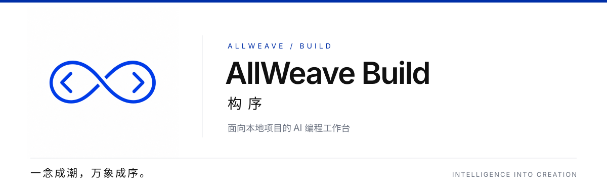
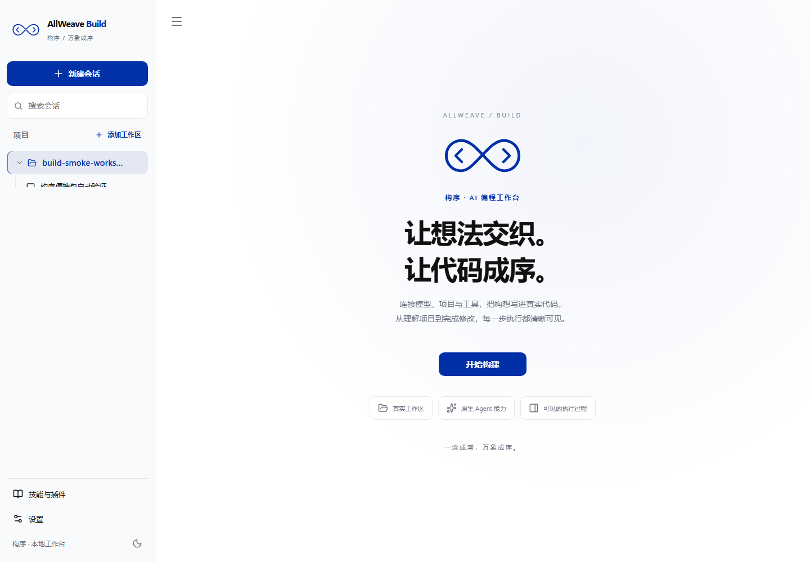

<p align="center">
  
</p>

<h1 align="center">AllWeave Build · 构序</h1>

<p align="center">
  <strong>让智能形成组织，让协作突破边界。</strong><br>
  从理解项目、修改代码到执行工具，把开发过程放进一个本地工作台。
</p>

<p align="center">
  <a href="#快速开始">快速开始</a> ·
  <a href="#能力">能力</a> ·
  <a href="#架构">架构</a> ·
  <a href="#开发">开发</a> ·
  <a href="#安全边界">安全</a>
</p>

---

## 从想法到代码

**AllWeave Build** 是面向本地项目的 AI 编程工作台。它提供浏览器界面、Windows 桌面封装和独立的内核运行时。会话、配置和工具执行都留在本机，模型请求由本地服务直接发往配置的供应商。

工作台已从 Pi coding-agent SDK 迁移到自研内核：

- `packages/kernel` 负责会话状态机、原生循环、工具执行、上下文构建、压缩、扩展和 SQLite 事件存储。
- `packages/kernel-adapters` 负责模型、MCP、codemode 等外部适配。
- `packages/ai` 只保留为模型 transport/auth 支持层；`telemetry`、`mcp`、`codemode` 同样作为可选支持层。
- 不再包含 Pi CLI、Pi TUI、Pi RPC、远程工作区或 Pi 扩展包加载。

实现与迁移记录见 [docs/ARCHITECTURE.md](docs/ARCHITECTURE.md) 和 [docs/note](docs/note/)。

## 快速开始

需要 Windows x64、Git 和 **Node.js 22.19 或更新版本**（推荐 24）。

```powershell
git clone https://github.com/bigtinda/allweave-build.git
cd allweave-build
npm ci --ignore-scripts
npm run hydrate:model-data
Copy-Item apps/server/.env.example .env
npm run dev:web
```

打开 **<http://127.0.0.1:5173>**，在“模型与设置”中配置供应商，然后选择项目目录并创建会话。请使用 `127.0.0.1`；本地服务校验 Host 与请求来源，`localhost` 不能直接替换。

Windows 安装包可从 [GitHub Releases](https://github.com/bigtinda/allweave-build/releases) 获取。安装包包含 Node.js、Electron 和工作台运行时；模型凭据仍需自行配置。



## 能力

| 能力 | 使用方式 |
| --- | --- |
| 项目工作区 | 添加本机文件夹，为不同项目组织会话 |
| 编程会话 | 流式回复、工具执行、会话恢复、撤回与分支 |
| 模型与供应商 | API Key / OAuth / 自定义兼容接口 |
| 工具确认 | plan / ask / auto / full 四种访问模式 |
| 原生工具 | read、write、edit、bash、grep、find、ls、browser |
| 可选扩展 | MCP、codemode、tool search、声明式 app plugins |
| Windows 桌面 | Electron 封装本地服务，以原生窗口打开工作台 |

## 架构

```text
apps/web/                  React / Vite / MUI / Monaco
apps/server/               Fastify / WebSocket / Zod / SQLite
  src/bootstrap/           唯一组合根、访问控制与生命周期
  src/sessions/            原生 runtime、actor、审批、事件投影
  src/workspaces/          本地工作区、文件与 Git
  src/persistence/         kernel store 适配与 JSONL 迁移读取
apps/shared/               服务端共享类型
packages/protocol/         纯 DTO 与事件 reducer
packages/kernel/           会话、循环、工具、上下文、存储、扩展
packages/kernel-adapters/  pi-ai、MCP、codemode 适配
packages/ai/               模型 transport/auth 支持层
packages/telemetry/        遥测支持层
packages/mcp/              MCP 协议实现
packages/codemode/         QuickJS-WASI 代码模式
packages/chord/            实验性应用组合运行时（非产品依赖）
packages/durable/          实验性持久化 harness（非产品依赖）
desktop/                   Electron 桌面封装
```

数据路径：

- `.pi-console/console.sqlite`：会话元数据、事件、快照、审批。
- `.pi-console/agent/auth.json`、`models.json`：模型凭据与自定义供应商。
- `.pi-console/sessions/`：旧版 JSONL 会话，仅用于迁移读取。

## 开发

```powershell
npm run check          # biome、边界门禁、类型检查、Web/Desktop 检查
npm run test:unit --workspace=@pi-console/server
npm run build:web
```

- 内核边界由 `scripts/check-kernel-boundaries.mjs --enforce` 强制：`packages/kernel` 不得依赖 Node I/O 或 Pi SDK，`apps/server` 不得 import Pi CLI/SDK。
- 新增会话行为优先改 `packages/kernel`；服务端只保留 transport、工作区和产品编排。
- 性能与轻量约束：单进程、无 DI/ORM/消息总线、事件批量写入、稳定前缀缓存、按需加载。

## 安全边界

API 与 WebSocket 校验本机 Host、Origin 和同源请求；当前没有通用访问令牌或 Cookie 登录层。文件工具检查授权根目录、真实路径、符号链接和私有配置路径。默认 ask 模式下，命令、写文件和自定义工具逐项确认，等待五分钟自动拒绝。

模型请求、获准命令和可信代码以当前 Windows 用户权限执行。工具批准不是 OS 沙箱；本应用面向本机可信项目，不应绑定公网或用于多用户隔离。

## 项目来源与许可证

本项目源自 [earendil-works/pi](https://github.com/earendil-works/pi)，保留 Pi 支持包与原有版权信息，并提供独立内核、本地 Web 工作台和 Windows 桌面封装。

代码使用 [MIT License](LICENSE)，原始版权声明见许可证文件。

---

<p align="center">
  <strong>AllWeave Build · 构序</strong><br>
  一念成潮，万象成序。
</p>
