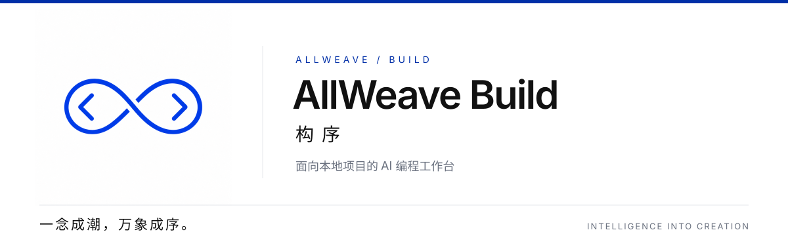
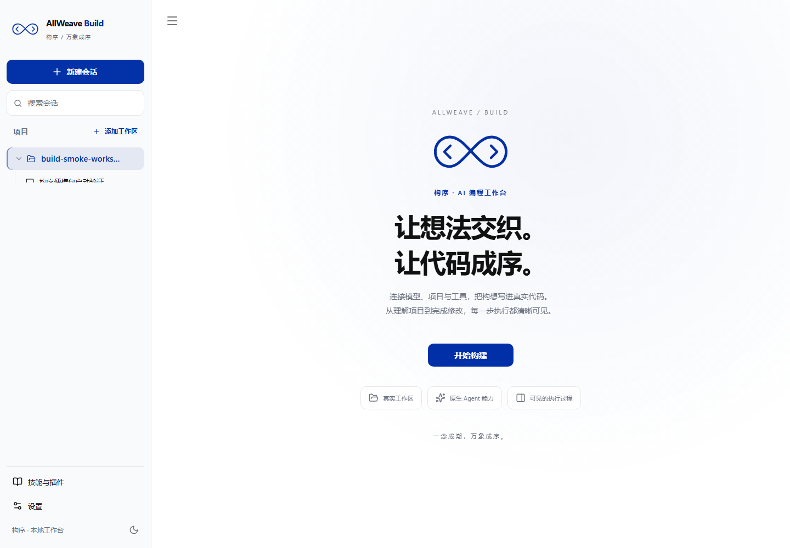

<p align="center">
  
</p>

<h1 align="center">AllWeave Build · 构序</h1>

<p align="center">
  <strong>让智能形成组织，让协作突破边界。</strong><br>
  从理解项目、修改代码到执行工具，把开发过程放进一个本地工作台。
</p>

<p align="center">
  <a href="#快速开始">快速开始</a> ·
  <a href="#工作方式">工作方式</a> ·
  <a href="#windows-桌面版">桌面版</a> ·
  <a href="#开发与扩展">开发与扩展</a> ·
  <a href="#项目来源与许可证">项目来源</a>
</p>

---

## 从想法到代码

**AllWeave Build** 是 AllWeave「万象成序」品牌体系中的 **Build · 构序**，面向本地项目的 AI 编程工作台。本仓库基于 Pi，提供浏览器工作台、Windows 桌面封装，以及可扩展的编程代理底层。

你可以选定项目目录、连接模型、提出任务，在同一个界面查看回复与工具执行过程，并在需要时批准操作。会话和配置保存在本机，Pi coding-agent SDK 以内嵌源码方式运行在本地服务进程中。

界面与桌面程序统一使用 **AllWeave Build · 构序** 品牌。底层包名保留 `@earendil-works/pi-*`；工作台直接使用仓库内 `packages/coding-agent` 及相关 Pi 源码，不依赖独立 Pi 可执行文件。

Windows 用户可从 [GitHub Releases](https://github.com/bigtinda/allweave-build/releases) 下载便携包，解压后运行 `AllWeaveBuild.exe`。包内包含 Node.js 和 Pi SDK 源码；模型凭据仍需自行配置，系统需具备 WebView2 Runtime。



| 能力 | 使用方式 |
| --- | --- |
| 项目工作区 | 添加本机文件夹，为不同项目组织会话 |
| 编程会话 | 向代理描述任务，查看流式回复与工具执行过程，恢复已有上下文 |
| 模型与供应商 | 使用 Pi 原生 API Key / OAuth 流程，或添加兼容模型接口 |
| 工具确认 | 按访问模式处理命令、文件写入及自定义工具操作 |
| 资源与扩展 | 使用 Skills、Extensions、提示模板和 Pi packages 调整工作流 |
| Windows 桌面 | 使用 Tauri 封装本地服务，以原生窗口打开工作台 |

## 快速开始

Web 工作台通过仓库中的 Pi coding-agent SDK 运行编程会话。准备 Windows x64、Git 和 **Node.js 24.3 或更新版本**。

### 1. 获取项目并安装依赖

```powershell
git clone https://github.com/bigtinda/allweave-build.git
cd allweave-build
npm ci --ignore-scripts
npm run hydrate:model-data
Copy-Item apps/server/.env.example .env
```

`hydrate:model-data` 需要网络连接，用于准备底层模型数据。已有 `.env` 时直接编辑现有文件，保留自己的配置。

### 2. 使用内置 Pi SDK

Pi coding-agent SDK 和相关运行时代码位于 `packages/`。它与工作台服务在同一 Node.js 进程中运行；升级 Pi 时更新仓库源码并重新启动服务，无需下载或解压独立内核。

### 3. 启动工作台

```powershell
npm run dev:web
```

也可以双击根目录的 `start-web.cmd`。打开 **<http://127.0.0.1:5173>**，在“模型与设置”中配置供应商，再选择项目目录并创建会话。

请使用 `127.0.0.1`：本地服务会校验 Host 与请求来源，`localhost` 不能直接替换这个地址。

## 工作方式

1. **选择项目**：添加并授权本机项目文件夹；也可在 `.env` 的 `PI_CONSOLE_ROOTS` 中配置目录，Windows 使用分号分隔。
2. **连接模型**：配置供应商凭据并选择模型，也可添加兼容接口。
3. **描述任务**：例如“解释登录流程”“修复这个报错”或“为这个函数补充测试”。
4. **检查执行**：查看回复与工具事件，按当前访问模式确认操作，再检查实际代码改动。
5. **继续会话**：回到已有会话，恢复 Pi 保存的上下文。

### 配置与数据

| 位置或变量 | 用途 |
| --- | --- |
| `.env` | 本地服务配置；示例见 [apps/server/.env.example](apps/server/.env.example) |
| `PI_CONSOLE_ROOTS` | 工作区目录，如 `D:/projects/app;D:/projects/library` |
| `PI_CONSOLE_DATA_DIR` | 控制台数据目录，默认 `.pi-console/` |
| `.pi-console/console.sqlite` | 会话界面状态 |
| `.pi-console/sessions/` | Pi 原生 JSONL 会话记录 |
| `.pi-console/agent/` | 默认 Pi 配置目录，包含供应商认证和自定义模型配置 |

API Key 和 OAuth 凭据由本地服务管理，浏览器不直接调用模型 API。项目内容仍会随请求发送给所选模型供应商；“本地工作台”表示程序和会话数据存储在本机。不要把凭据写入 `VITE_*` 变量或提交到 Git。

### 访问边界

工作台面向本机单用户与可信项目，服务默认只监听 `127.0.0.1`，并校验访问令牌、Host 和 Origin。工具访问会检查授权目录与路径。

Pi SDK、可信扩展和获准命令使用当前 Windows 用户权限。界面中的工具确认不提供操作系统级隔离；需要更强隔离时，参阅 [容器与沙箱说明](packages/coding-agent/docs/containerization.md)。

## Windows 桌面版

桌面版用 Tauri 启动本地 Node.js 服务，并在 Windows 原生窗口中打开工作台。关闭窗口时会停止服务进程树。

自行打包需要 **Rust 1.90 或更新版本**、Visual Studio C++ Build Tools、WebView2 Runtime，以及上述依赖。

在 PowerShell 中执行：

```powershell
.\desktop\build-portable.ps1 -BuildWeb
```

产物为 `desktop/dist/AllWeaveBuildPortable.zip`。解压后运行 `AllWeaveBuild.exe`，无需安装程序。包内自带 Node.js 和 Pi SDK 源码。目录必须可写，会话、模型配置和 WebView 数据保存在程序旁的 `data/` 目录。

默认授权同目录下的 `workspaces/`。在 `workspace-roots.txt` 中逐行加入其他项目目录后重启程序。固定版本 WebView2 的打包方式见 [桌面版说明](desktop/README.md)。

## 开发与扩展

### 仓库结构

```text
apps/
  web/          React、Vite、MUI、Monaco 前端
  server/       Fastify、WebSocket、SQLite 本地服务
  shared/       前后端共享协议
desktop/        Tauri Windows 桌面封装与便携包脚本
packages/       Pi 编程代理与底层库
scripts/        开发、校验与打包工具
docs/brand/     AllWeave Build README 品牌资源
```

浏览器通过 HTTP / WebSocket 连接本地服务，本地服务通过 Pi 的 RPC（进程间请求与事件协议）控制编程内核。模型调用与工具执行在服务端和内核中完成。

### 常用命令

| 命令 | 用途 |
| --- | --- |
| `npm run dev:web` | 同时启动 Web 前端与本地服务 |
| `npm run check:web` | 检查 Web 前后端 TypeScript 类型 |
| `npm run check` | 仓库格式、静态检查、类型及依赖校验；会写入格式修正 |
| `npm run build:web` | 构建生产前端 |
| `npm run build` | 刷新模型数据并构建底层包 |
| `npm run build:offline` | 使用已有模型数据构建底层包 |
| `./test.sh` | 在隔离环境中运行非真实模型调用测试；Windows 使用 Git Bash |
| `.\pi-test.ps1` | 在 PowerShell 中运行 Pi 源码 CLI |

构建生产前端后，可运行 `npm run dev --workspace=@pi-console/server`，由本地服务在 **<http://127.0.0.1:8787>** 提供前端资源。具体配置见 [Web 工作台说明](apps/README.md)。

### 扩展入口

- [Skills](packages/coding-agent/docs/skills.md)：为代理提供可复用的任务说明和资源。
- [Extensions](packages/coding-agent/docs/extensions.md)：扩展工具、事件与交互行为。
- [提示模板](packages/coding-agent/docs/prompt-templates.md)：复用常见任务的提示内容。
- [Pi packages](packages/coding-agent/docs/packages.md)：通过 npm 或 Git 分发扩展资源。
- [TypeScript SDK](packages/coding-agent/docs/sdk.md)：在自己的应用中使用 Pi 编程代理。
- [RPC](packages/coding-agent/docs/rpc.md)：从外部进程控制代理。
- [CLI](packages/coding-agent/docs/cli.md) 与 [终端主题](packages/coding-agent/docs/themes.md)：使用和定制底层命令行界面。

底层包文档：[模型 API](packages/ai/README.md) · [代理运行时](packages/agent/README.md) · [编程 CLI](packages/coding-agent/README.md) · [持久化运行时](packages/durable/README.md) · [终端 UI](packages/tui/README.md) · [应用组合](packages/chord/README.md) · [遥测](packages/telemetry/README.md)。

Pi 原始仓库介绍中的 Nix、独立二进制构建、本地包分发与供应链说明保留在 [README.pi.md](README.pi.md)。开发前请阅读 [AGENTS.md](AGENTS.md) 和 [CONTRIBUTING.md](CONTRIBUTING.md)。

## 品牌表达

本项目采用 **Build · 构序** 标识：代码括号与无限交织线条结合，表达从想法到实现的持续构建。**Write · 言序** 与 **Team · 共序** 属于同一品牌体系，本仓库的产品范围为 Build。

| 色彩 | 色值 | 角色 |
| --- | --- | --- |
| Klein Blue | `#002FA7` | 品牌主色与关键强调 |
| Graphite | `#111111` | 主要文字 |
| Gray | `#6B7280` | 辅助文字 |
| Light Gray | `#E5E7EB` | 分隔与背景 |
| White | `#FFFFFF` | 基础色与留白 |

README 采用白底、蓝色标识与清晰的阅读层级。页首使用提供的 Build 标识，资源存放在 [docs/brand/](docs/brand/)。

## 项目来源与许可证

本项目基于 [earendil-works/pi](https://github.com/earendil-works/pi)，保留 Pi 底层包与原有版权信息，并在此基础上提供本地 Web 工作台和 Windows 桌面封装。

代码使用 [MIT License](LICENSE)，原始版权声明见许可证文件。

---

<p align="center">
  <strong>AllWeave Build · 构序</strong><br>
  一念成潮，万象成序。
</p>
