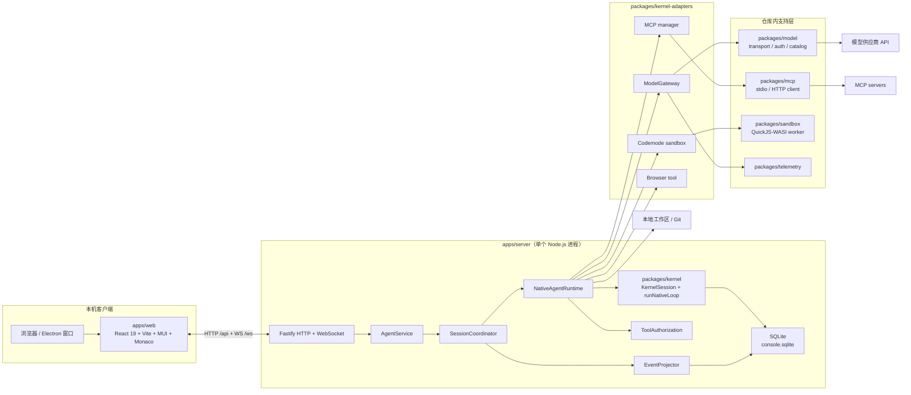
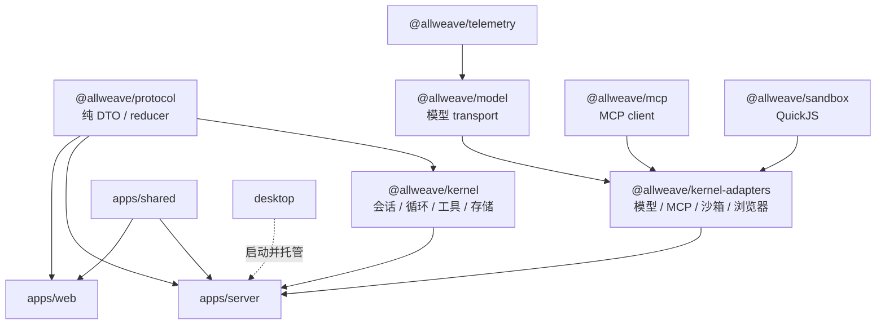
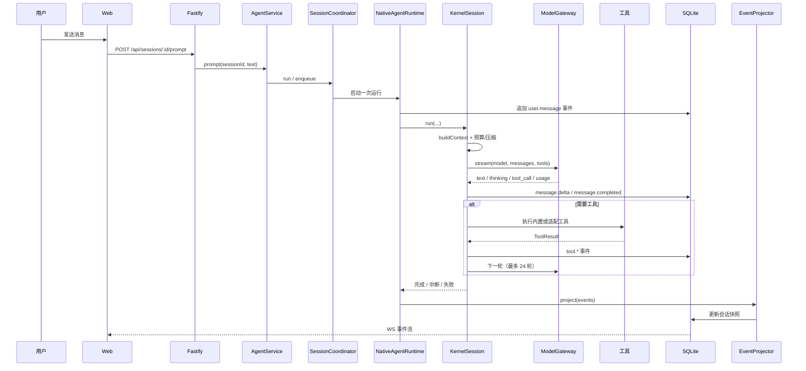
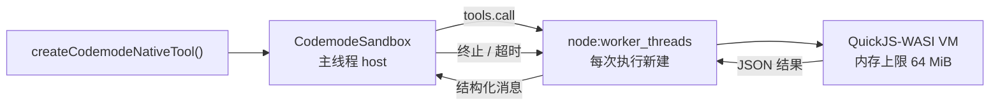

# AllWeave Build 架构（1.2.1）

> 状态：当前实现说明，不是迁移计划。  
> 基线：`1.2.1`（2026-11）。产品运行时全部位于本仓库，使用 `@allweave/*` 命名空间。  

## 1. 1.2.1 的边界

1.2.1 把工作台收敛为一条本地、单进程、可独立构建的运行时：

- 会话、模型调用、工具执行、审批和持久化都由 `apps/server` 在本进程内组合，没有独立的 agent 进程、CLI 或 RPC 控制面。
- 内核 `packages/kernel` 只负责会话状态机、循环、工具协议、上下文和事件存储，不依赖 HTTP、UI、模型 transport 或具体工具供应商。
- 模型、MCP、工具沙箱和浏览器是 `packages/kernel-adapters` 的适配层；服务端只负责产品编排。
- 工具沙箱 `packages/sandbox` 随仓库分发，作为服务端进程内的 QuickJS-WASI worker 运行；不依赖外部代码执行服务。
- 版本号统一从 `1.2.1` 起步：根包、全部 `@allweave/*` 包、服务端 `KERNEL_VERSION`、桌面清单保持一致。
- 已删除实验性的 `chord`、`durable` 包，以及旧版包安装、doompi host、子智能体安装入口。

## 2. 运行拓扑



关键点：

- 浏览器和 Electron 渲染进程只通过 HTTP/WebSocket 与本机服务通信，不直接访问文件、模型凭据或 SQLite。
- 模型请求由服务端进程直接发出；没有云端中转。
- MCP server 和模型供应商是可选外部依赖；没有配置时对应工具不出现。
- 沙箱不是独立进程池：每次代码模式执行临时创建一个 worker，执行结束即销毁。

## 3. 包与依赖方向



| 层 | 包 | 允许依赖 | 不负责 |
| --- | --- | --- | --- |
| DTO | `packages/protocol` | 仅相对导入 | 运行逻辑、Node API |
| 内核 | `packages/kernel` | `@allweave/protocol`、`node:sqlite`（仅 store） | HTTP、React、模型、MCP、沙箱 |
| 适配 | `packages/kernel-adapters` | kernel、model、mcp、sandbox | 路由、会话投影、UI |
| 支持 | `packages/{model,mcp,sandbox,telemetry}` | 各自第三方 SDK | 产品编排 |
| 服务 | `apps/server` | 上述全部 | 渲染与浏览器 DOM |
| Web | `apps/web` | `@allweave/protocol`、`apps/shared` | 内核、适配器、Node API |

`scripts/check-kernel-boundaries.mjs --enforce` 检查这些方向：内核禁止导入模型/MCP/沙箱/HTTP/React，Web 禁止导入内核和适配器，`node:sqlite` 只允许出现在三个存储模块中。

## 4. 一次提示的执行路径



服务端只做三件事：鉴权与路由、运行编排、事件投影。模型循环、工具调用和上下文压缩都在内核中完成。

## 5. 内核

### 5.1 会话状态机

`packages/kernel/src/session/session.ts` 维护单个会话：

- 状态：`idle`、`running`、`approval`、`error`、`interrupted`。
- 运行时只允许一个活动运行；停止、撤回和分支通过 `navigate()` 截断事件序列实现。
- 事件先追加到 `kernel_session_events`，再异步生成快照；服务端 `EventProjector` 把内核事件投影为前端 DTO。
- `kernel_branches` 表保留在 schema 中但当前未写入；分支语义由“截断 + 重新投影”完成。

### 5.2 原生循环

`packages/kernel/src/engine/loop.ts` 是唯一的 agent 循环：

```text
buildContext
  -> stream model
  -> append assistant message
  -> if tool calls: execute tools, append results, repeat
  -> else: finish
```

约束：

- `MAX_TURNS = 24`，`MAX_RETRIES = 2`，单次工具输出上限 `120_000` 字符。
- 工具执行前经过 `ToolPolicy`：`plan` 只读、`ask` 逐项审批、`auto` 自动执行、`full` 全部放行。
- 中断会终止当前流、取消待执行工具，并把状态置为 `interrupted`；已完成文件修改不回滚。
- 运行失败保留已写入事件，错误写入会话状态，前端可恢复或重试。

### 5.3 上下文与压缩

`packages/kernel/src/context/`：

- `builder.ts` 组装系统提示、资源、技能、工作区信息和历史消息。
- `budget.ts` 估算 token；`compaction.ts` 在接近上下文窗口时生成摘要并保留近期消息。
- 稳定前缀保持缓存友好：系统提示、工具定义和资源顺序不随会话轮次变化。
- 压缩是确定性截断与摘要的组合，不依赖第二次模型调用之外的外部服务。

### 5.4 工具

内置工具在 `packages/kernel/src/engine/tools.ts`：

| 工具 | 作用 | 关键限制 |
| --- | --- | --- |
| `read` | 读取 UTF-8 文件 | 单次最多 1 MiB，拒绝二进制和越权路径 |
| `write` | 创建或覆盖文件 | 先检查授权根、真实路径、符号链接 |
| `edit` | 精确文本替换 | 需要唯一匹配，失败不写入 |
| `bash` | 执行命令 | 需审批；工作目录限制在授权根 |
| `grep` / `find` / `ls` | 搜索与列目录 | 不跟随越权符号链接 |

工具输出统一截断后写回事件，避免单条结果撑爆上下文和 WebSocket。

### 5.5 持久化

`packages/kernel/src/store/schema.ts` 定义：

| 表 | 用途 |
| --- | --- |
| `kernel_sessions` | 会话元数据、文件路径、最后序号 |
| `kernel_session_events` | 追加式事件日志，主键 `(session_id, seq)` |
| `kernel_session_snapshots` | 投影快照，减少重放成本 |
| `kernel_approvals` | 待审批工具调用、状态、过期时间 |
| `kernel_branches` | 预留分支表，当前未写入 |

SQLite 使用 WAL。写入按 16 ms / 64 条批量提交；关闭前 flush。`apps/server/src/persistence/kernel-session-store.ts` 负责旧 JSONL 的一次性迁移和审批 API。

### 5.6 扩展注册表

`packages/kernel/src/extensions/` 定义工具、资源、提示和事件的注册协议。当前产品只注册内置工具和适配层工具；扩展注册表保留为稳定的内核端口，不直接加载第三方代码。应用级插件是另一条路径，见第 10 节。

## 6. 模型层

`packages/model` 是仓库内的模型传输层：

- `models.generated.ts` + `providers/data/*.json`：供应商与模型目录。
- `api/*`：Anthropic Messages、OpenAI Completions/Responses、Google Generative AI、Bedrock、Mistral、AllWeave Messages 等 wire API。
- `providers/*`：懒加载的 provider 工厂；只有被请求的 provider 才加载对应 SDK。
- `oauth` / `auth`：API Key、OAuth、环境变量和 `auth.json`。
- 统一事件：文本、thinking、tool call、usage、错误。

`packages/kernel-adapters/src/model/gateway.ts` 是产品唯一入口：

- `ModelGateway.stream()` 把内核消息转换成 wire 消息，返回 `NativeModelEvent`。
- `modelOption()` 生成前端可展示的模型信息。
- `GatewayUsage` 汇总输入、输出、缓存和推理 token，供会话统计使用。

内核不直接依赖 `@allweave/model`；替换模型传输层只需保持网关接口。

## 7. 工具沙箱

沙箱是本项目保留并内嵌的能力，位于 `packages/sandbox`。

### 7.1 执行模型



- host 持有工具表、截止时间和 abort 信号。
- 每次 `execute()` 创建新的 worker 和新的 QuickJS VM，执行完即销毁。
- VM 内通过 `tools.<name>(arg)` 调用 host 工具；参数和结果只走 JSON，不共享对象。
- host 工具在主线程执行，因此仍受内核 `ToolPolicy` 和审批约束。
- 默认执行超时 60 秒（适配层可调），默认内存上限 64 MiB；输出和存储值有字符上限。

### 7.2 产品接入

`packages/kernel-adapters/src/sandbox/tool.ts`：

- `createCodemodeNativeTool(callableTools)` 生成 `codemode` 工具。
- 只有只读工具暴露给脚本；写文件、命令等仍走原生工具和审批。
- 会话级开关：`ALLWEAVE_CODEMODE=off` 时不注册该工具。
- 沙箱不替代 OS 权限边界：它限制脚本的 CPU/内存/输出，不限制 host 工具本身的权限。

### 7.3 为什么内嵌

外部代码执行服务会引入网络跳转、额外部署和凭据传递。内嵌 QuickJS 让沙箱随服务启动、随会话销毁，保持单进程和本地数据边界；代价是每次执行有 worker/WASM 启动开销，因此只用于代码模式脚本，不用于普通文件工具。

## 8. MCP

`packages/mcp` 是仓库内的 MCP 客户端：

- `StdioTransport`：`cross-spawn` 启动子进程，JSON-RPC 按行传输。
- `StreamableHttpTransport`：HTTP POST + SSE 响应。
- `McpClient`：初始化、工具列表、调用、取消、进度、roots、OAuth token 注入。
- 超时和关闭由客户端管理；子进程随 manager 关闭。

`packages/kernel-adapters/src/mcp/`：

- `loadMcpConfig()` 读取全局配置和可信项目的 MCP 配置。
- `createMcpManager()` 管理连接池和重连。
- `createMcpNativeTools()` 把 MCP 工具映射为 `mcp_<server>_<tool>`。
- 插件开发会话默认不加载 MCP；`ALLWEAVE_MCP=off` 可全局关闭。

## 9. 服务端

### 9.1 组合根

`apps/server/src/bootstrap/create-app.ts` 是唯一组合根：

1. 打开 `ConsoleStore` 和 `KernelSessionStore`。
2. 初始化 `WorkspaceService`、`ProviderManager`、`BrowserService`、`AppPluginManager`。
3. 构造 `AgentService` 和 `SessionCoordinator`。
4. 注册 HTTP/WebSocket 路由、静态前端、关闭钩子。
5. 统一挂 Host/Origin/同源校验和错误处理。

### 9.2 服务对象

| 对象 | 职责 |
| --- | --- |
| `AgentService` | 会话 facade：创建、列表、提示、停止、恢复、模型切换、资源与诊断 |
| `SessionCoordinator` | 单会话串行化、运行注册、事件订阅、审批和插件变更刷新 |
| `SessionRuntimeRegistry` | 运行时实例生命周期 |
| `NativeAgentRuntime` | 把内核、模型网关、工具、MCP、沙箱、浏览器接起来 |
| `EventProjector` | 内核事件 → `SessionMeta` v3 / 前端事件 |
| `ToolAuthorization` | 5 分钟审批窗口、持久化审批、策略检查 |
| `WorkspaceService` | 授权根、文件、Git、Office 预览 |
| `StorageManager` | 数据目录统计与 SQLite 压缩 |

### 9.3 HTTP 与 WebSocket

- 会话：`/api/sessions*`，含创建、消息、撤回、分支、模型、访问模式、审批、恢复。
- 工作区：`/api/workspaces*`、文件、图片、文档预览、Git。
- 资源：`/api/skills*`、`/api/models`、`/api/storage*`。
- 供应商：`/api/providers*`、`/api/provider-logins*`。
- 浏览器：`/api/browser*`、`/ws/browser/:id`。
- 应用插件：`/api/app-plugins*`。
- 会话流：`/ws/sessions/:id`，先发快照，再按 `seq` 重放；4 MiB 背压阈值，浏览器流 2 MiB。

服务只监听 `127.0.0.1`，校验 Host、Origin 和 `Sec-Fetch-Site`；写请求必须带 Origin。桌面模式额外使用一次性 shutdown token。

## 10. 应用插件

应用插件是声明式数据层，不是任意代码扩展：

- 清单 `manifestVersion: 1`：字段（text/number/date/boolean/select）、视图（table/board）、导航。
- 安装在 `<data>/releases/<pluginId>/<digest>/`，注册表在 `<data>/registry.json`。
- 每个工作区独立保存记录；服务端校验清单、字段和视图。
- Web 按清单渲染表格/看板，不执行插件提供的 JavaScript。
- 启用/禁用/删除会刷新空闲运行时；运行中的会话不受影响。

这条路径替代了旧的“安装外部包并加载扩展”模型。

## 11. Web 与桌面

`apps/web`：

- React 19、Vite、MUI、React Query、Monaco。
- 路由：工作台、会话、技能、应用插件、设置（供应商、插件、浏览器、用量、归档、存储、系统）。
- 所有 API 通过 `src/services/api.ts`；WebSocket 事件由 `EventProjector` 的 DTO 驱动。
- 不导入内核或适配器；只共享 `@allweave/protocol` 和 `apps/shared`。

`desktop`：

- Electron 主进程在空闲端口启动 Node 服务，使用 `source-resolver` 解析源码/打包路径。
- 渲染进程加载 `http://127.0.0.1:<port>`，通过 preload 暴露窗口控制。
- 数据目录固定在桌面应用数据目录；`ALLWEAVE_AGENT_DIR` 可覆盖模型配置目录。
- 关闭时调用带 token 的 `/api/desktop/shutdown`，超时后终止子进程。

## 12. 数据与配置

```text
<data>/
  console.sqlite          会话、事件、快照、审批、工作区
  console.sqlite-wal
  agent/
    auth.json             模型凭据
    models.json           自定义供应商
    skills/               用户技能
  sessions/               旧 JSONL，仅迁移读取
  releases/               应用插件版本
  registry.json           应用插件注册表
```

环境变量：

| 变量 | 默认 | 说明 |
| --- | --- | --- |
| `ALLWEAVE_PORT` | `8787` | 服务端口，仅 loopback |
| `ALLWEAVE_ROOTS` | 仓库根 | 额外授权根，Windows 用 `;` |
| `ALLWEAVE_DATA_DIR` | `<repo>/.allweave` | 数据目录 |
| `ALLWEAVE_AGENT_DIR` | `<data>/agent` | 模型配置目录 |
| `ALLWEAVE_MCP` | 开 | `off` 关闭 MCP |
| `ALLWEAVE_CODEMODE` | 开 | `off` 关闭代码模式工具 |
| `ALLWEAVE_DESKTOP` | `0` | 桌面模式标记 |
| `ALLWEAVE_SHUTDOWN_TOKEN` | 空 | 桌面关闭令牌 |

旧版数据目录和旧包配置不再读取；升级时需手动迁移会话或重新配置供应商。

## 13. 安全边界

- 网络：仅监听 `127.0.0.1`；校验 Host、Origin、同源；没有通用登录层，默认假设本机单用户。
- 文件：授权根 + 真实路径 + 符号链接检查；拒绝 `.git`、凭据目录等私有路径的写入。
- 命令：`ask` 模式逐项审批，5 分钟未响应自动拒绝；`auto`/`full` 由用户显式选择。
- 模型：API Key 只存服务端 `auth.json` 或环境变量，不进入浏览器。
- 沙箱：QuickJS 限制内存、输出和执行时间，但 host 工具仍以当前用户权限运行。
- 插件：应用插件只提供声明式数据，不执行 JavaScript；MCP server 和模型供应商是可信外部进程/服务。

**不要**把服务绑定到公网或用于多用户隔离；当前没有 OS 级沙箱或多租户边界。

## 14. 构建与版本

```powershell
npm ci --ignore-scripts
npm run hydrate:model-data
npm run check
npm run build:web
```

- 版本源：根 `package.json`、各 `@allweave/*` 包、`apps/server/src/version.ts`、`desktop/desktop.json` 必须同为 `1.2.1`。
- 模型目录由 `packages/model/scripts/generate-models.ts` 生成；不要手改 `models.generated.ts`。
- 打包（Electron 安装包、签名、发布）不在本仓库脚本的默认流程内；由发布方单独执行。

## 15. 设计取舍

| 决策 | 原因 | 代价 |
| --- | --- | --- |
| 单进程、无 CLI/RPC | 启动快、部署简单、事件不跨进程序列化 | 长任务与服务共享事件循环 |
| 内核不依赖模型/MCP/沙箱 | 可替换适配层，边界可测试 | 适配层需要显式转换类型 |
| SQLite 追加事件 + 快照 | 恢复、分支、审计简单 | 数据库会增长，需要压缩 |
| 沙箱内嵌 QuickJS | 无外部服务、随会话销毁 | 每次执行有 worker 启动成本 |
| 应用插件声明式 | 不执行第三方 JS，安全边界清晰 | 表达能力有限 |
| 供应商目录内置 | 离线可用、类型完整 | 目录更新需要重新生成 |

## 16. 已知边界

- `kernel_branches` 表未使用；分支通过截断事件实现。
- 上下文压缩是启发式预算，不保证与供应商 tokenizer 完全一致。
- 沙箱只限制脚本资源，不限制 host 工具权限。
- 应用插件没有市场/远程安装，只有本地导入和内置示例。
- 旧数据目录、旧包配置和旧扩展不会自动迁移。
- Windows 是主要目标平台；其他平台未做完整验证。

## 17. 许可证与来源

代码使用 MIT License。仓库内模型、MCP 和沙箱支持层包含基于 MIT 许可的衍生实现，原始版权声明保留在根 `LICENSE` 中。产品名称、包命名空间和运行时编排属于 AllWeave Build。
