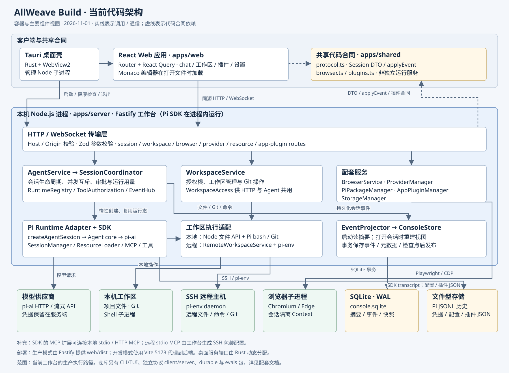
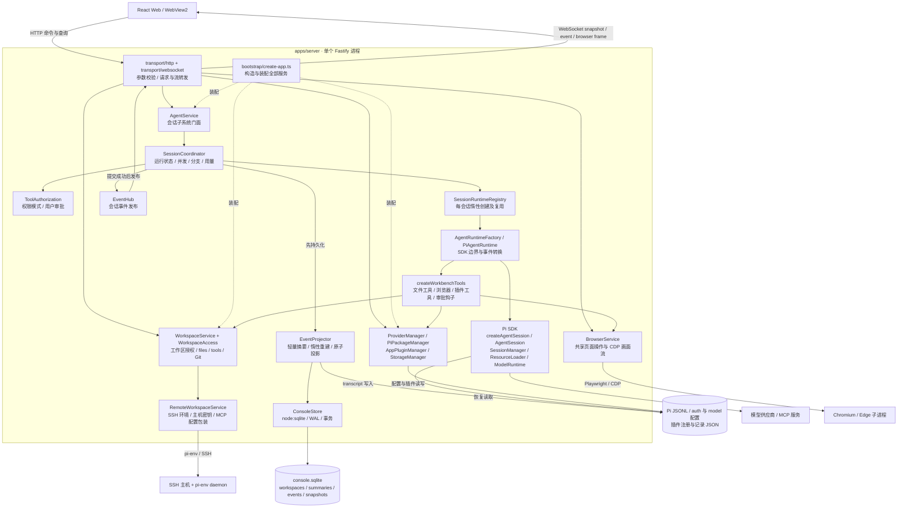
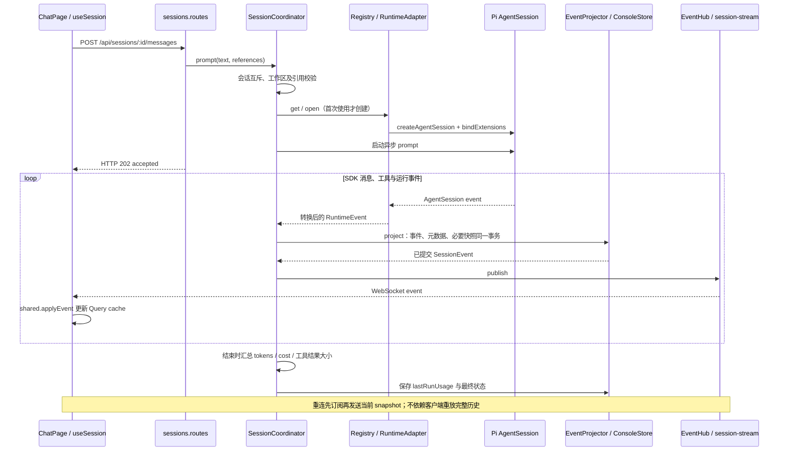
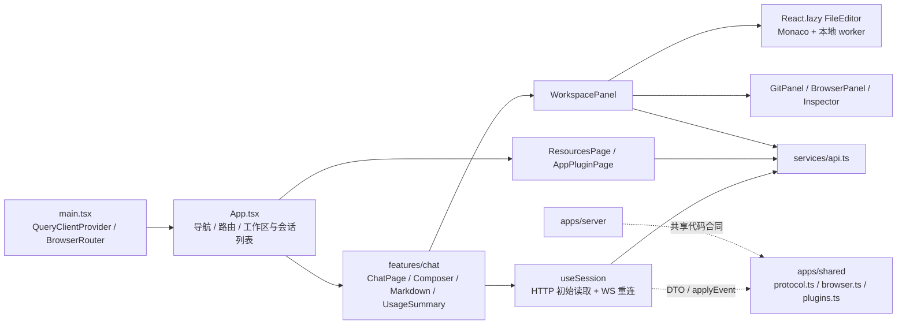

# 当前代码架构图

代码检查日期：2026-11-01。依据当前工作树中的入口、实际对象构造、导入与调用代码绘制，没有以 README 或既有架构规划作为架构依据。此文档是当前实现快照，不是目标设计；图中省略叶子工具和 UI 展示组件。

## 1. 运行与部署边界

- 工作台是本机单用户应用：React Web 客户端通过同源 HTTP 与 WebSocket 访问一个 Fastify Node 进程。Pi SDK 在该进程内创建会话，没有经独立 Pi RPC 服务执行工作台聊天。
- Windows 桌面入口是 Rust/Tauri：创建数据目录、启动 Node 子进程、检查 `/api/health`，再让 WebView2 打开本机服务 URL；退出时请求关闭，超时通过 Windows Job Object/进程终止回收。
- 生产 Web 静态产物由 Fastify 托管；开发时 Vite 5173 代理 `/api`、`/ws`。桌面后端使用动态端口，普通服务默认 8787。
- 服务端浏览器是 Playwright 管理的 Chromium/Edge 子进程，每个聊天使用独立 BrowserContext。它与显示应用 UI 的 WebView2/普通浏览器是不同的角色。
- SSH 工作区通过 `pi-env` 的远程 daemon 操作文件、命令和 Git。模型 API、浏览器子进程、MCP 服务及 SSH 主机不属于 Fastify 进程内部组件。

## 2. 后端组件与依赖方向

实线表示实际调用/事件传递；虚线表示使用接口或共享代码。所有 Server 内部节点均在同一 Node 进程内，矩形不代表微服务。

`WorkspaceAccess` 同时供 HTTP 文件 API 和 Agent 文件工具使用，但 `files()` 与 `tools()` 是不同接口，本地和远程路径限制也保留各自实现。本地 bash 继续使用 SDK 后端；仅远程 bash 注入 `BashOperations`。统一调用入口不等于所有命令都经过同一个文件访问实现。

## 3. 一次聊天的真实执行链

需要确认的工具由工具调用钩子进入 `ToolAuthorization`，经相同投影和 WebSocket 通道呈现审批；UI 通过审批 HTTP 接口回复。投影失败时禁止发布未提交事件，并标记该会话需要恢复。

上图表达逻辑阶段；202 只表示任务已接受，实际 WebSocket 事件可能先于 HTTP 响应到达。

## 4. 前端与共享合同

当前只有聊天明确归组为 `features/chat`。工作区、浏览器及其他 UI 仍主要位于共享 `components` 和 `pages`，没有把尚未存在的 feature 目录画成已完成模块。`apps/shared` 是源码共享包，不是单独运行的服务或消息代理。

## 5. 存储职责与 Monorepo 范围

| 实际存储 | 写入/读取组件 | 当前职责 |
| --- | --- | --- |
| `console.sqlite`，WAL | ConsoleStore、EventProjector、WorkspaceService | 工作区、会话摘要/UI 元数据、事件、压缩快照与检查点 |
| Pi 会话 JSONL | SDK SessionManager 写入；transcript reader 读取 | Pi 历史、分支与模型上下文的会话记录 |
| `auth.json`、`models.json`、`models-store.json` 等 | ProviderManager、SDK ModelRuntime | 服务端凭据、模型与配置，不发往 Web 客户端 |
| 应用插件 registry、release、records JSON | AppPluginManager | 声明式应用插件清单和业务记录，独立于 ConsoleStore |

启动常态只加载会话摘要；打开会话时由 transcript、UI 元数据及必要快照/事件恢复视图。旧数据库可能先执行迁移，不能把“常态惰性读取”误画成“任何旧数据库启动都不读取快照”。快照与 JSONL 当前仍共存，证据不足的旧稀疏元数据会拒绝恢复。

仓库还包含 `packages/`：工作台主会话路径使用 `coding-agent → agent core / ai`，SDK 同时组合 TUI、MCP、codemode 等能力；SSH 适配使用 `env`，其实现引用 durable 的 ExecutionEnv 类型/能力。`packages/client`、`packages/protocol`、`packages/server` 提供另一套协议客户端/服务端能力，**不是**本图中 `apps/server` HTTP 工作台的必经中间层。`durable` 的 Harness 和 `evals` 也没有被本次核实的工作台主会话调用链直接用作会话协调器。

## 6. 源码核对入口

以下为本次直接阅读或追踪调用的代码位置，链接相对本文件：

| 结论 | 代码依据 |
| --- | --- |
| 启动、服务装配、同源限制及静态托管 | [main.ts](../../apps/server/src/main.ts)、[create-app.ts](../../apps/server/src/bootstrap/create-app.ts) |
| 桌面进程与 WebView2 生命周期 | [Rust main.rs](../../desktop/src-tauri/src/main.rs) |
| 运行态、互斥、审批和 SDK 边界 | [agent.ts](../../apps/server/src/agent.ts)、[coordinator.ts](../../apps/server/src/sessions/coordinator.ts)、[runtime-registry.ts](../../apps/server/src/sessions/runtime-registry.ts)、[pi-runtime.adapter.ts](../../apps/server/src/sessions/pi-runtime.adapter.ts)、[tool-factory.ts](../../apps/server/src/sessions/tool-factory.ts) |
| 事务投影、惰性恢复与 WS | [event-projector.ts](../../apps/server/src/sessions/event-projector.ts)、[store.ts](../../apps/server/src/store.ts)、[sessions.routes.ts](../../apps/server/src/transport/http/sessions.routes.ts)、[session-stream.ts](../../apps/server/src/transport/websocket/session-stream.ts) |
| 本地与 SSH 后端 | [workspace-access.ts](../../apps/server/src/workspaces/workspace-access.ts)、[command-operations.ts](../../apps/server/src/workspaces/command-operations.ts)、[remote-workspaces.ts](../../apps/server/src/remote-workspaces.ts)、[ssh.ts](../../packages/env/src/ssh.ts) |
| 浏览器、配置及应用插件 | [browser.ts](../../apps/server/src/browser.ts)、[providers.ts](../../apps/server/src/providers.ts)、[app-plugins.ts](../../apps/server/src/app-plugins.ts)、[remote-mcp.ts](../../apps/server/src/remote-mcp.ts) |
| 前端实际通信与模块边界 | [main.tsx](../../apps/web/src/main.tsx)、[App.tsx](../../apps/web/src/App.tsx)、[ChatPage.tsx](../../apps/web/src/features/chat/ChatPage.tsx)、[useSession.ts](../../apps/web/src/features/chat/useSession.ts)、[api.ts](../../apps/web/src/services/api.ts)、[WorkspacePanel.tsx](../../apps/web/src/components/WorkspacePanel.tsx) |
| SDK 实际组合 | [sdk.ts](../../packages/coding-agent/src/core/sdk.ts)、[agent.ts](../../packages/agent/src/agent.ts)；各 package manifest 用于交叉核对声明依赖 |

本次仅新增架构图和说明，没有修改业务代码，也没有通过重新运行全仓测试来声称运行正确性；验证范围为静态代码关系和图文件本身。
