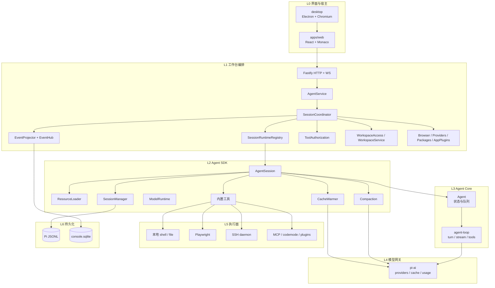
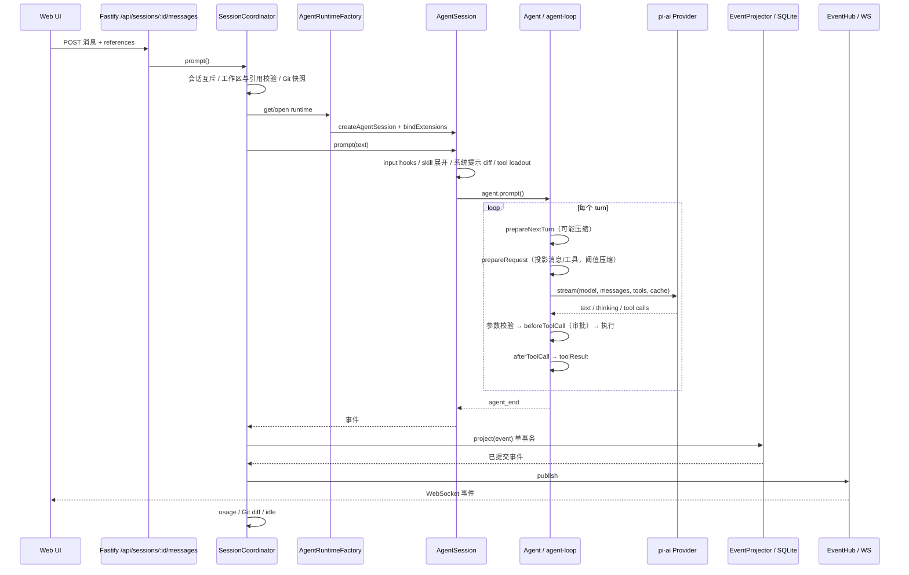
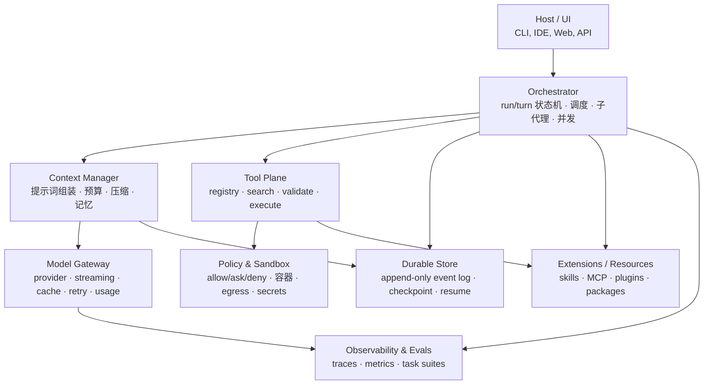

# Harness 成熟度评估与优化路线

> 代码检查日期：2026-11-02。依据当前工作树中的入口、对象构造、导入与调用代码，不以 README 或既有架构规划作为唯一依据。
>
> 范围：工作台主会话链路（`apps/server` → `packages/coding-agent` → `packages/agent` → `packages/ai`），以及仓库内未被主链路使用的并行运行时。本文是评估与优化建议，不是已实施记录。
>
> 归档说明（2026-11-03）：本文作为审计证据保留。桌面技术栈当时已由 Tauri 迁至 Electron，文中桌面描述已按 Electron + 内置 Chromium 更正；代码行号可能随后续提交漂移，以当前代码为准。

## 结论

这个项目已经是一个能真实运行的 coding agent harness，不是玩具。主循环、工具调用、会话、压缩、多供应商、缓存控制都已具备。若以“成型、可长期运行、可度量、可安全执行”的生产级 harness 为标准，差距主要不在模型能力，而在五件事：

1. 统一运行时；
2. 崩溃恢复；
3. 执行隔离；
4. 可观测与评测；
5. 上下文预算与工具治理。

仓库里实际存在三套并行的运行时：

| 运行时 | 位置 | 是否用于工作台主链路 |
| --- | --- | --- |
| Pi classic：`Agent` + `agent-loop` + `AgentSession` | `packages/agent`、`packages/coding-agent` | 是 |
| Pico5 durable harness：事件溯源、任务图、检查点、恢复 | `packages/durable/src/harness` | 否，只在 `coding-agent/src/experimental` 使用 |
| RPC/worker：`protocol` + `client` + `server` | `packages/protocol`、`client`、`server` | 否，实验性远程/worker 路径 |

### 成熟度记分卡

等级定义：L1 原型、L2 可用、L3 稳健、L4 生产级。

| 维度 | 当前等级 | 依据 |
| --- | --- | --- |
| 主循环与工具调用 | L3 | `agent-loop` 支持并行/顺序工具、hooks、abort、steering；工具覆盖基本读写执行 |
| 上下文管理 | L3 | 自动压缩、溢出恢复、结构化摘要、cache warmer；估算与压缩请求仍不够精细 |
| 模型网关 | L3–L4 | 多 provider、流式、`cache_control`、用量/成本、重试、OAuth |
| 持久化与恢复 | L2 | JSONL + SQLite 双写、事务投影；无 in-flight run 恢复，审批只在内存 |
| 安全隔离 | L1–L2 | 路径/审批/Host/Origin 校验；无 OS sandbox，项目扩展自动信任 |
| 工具治理 | L2 | 核心工具 + browser/plugins；无本地 tool search、repo map、结构化 diagnostics |
| 可观测与评测 | L1 | 有 usage 记录；telemetry 未接入，evals 仅 docs-lift |
| 扩展生态 | L3 | skills/extensions/MCP/codemode/app plugins；信任与发现机制待加强 |
| 代码结构 | L1–L2 | 功能齐全但 `AgentSession` 4398 行、三套并行栈、重复实现 |

## 一、当前项目的真实分层架构

每一层只依赖它下面的层，箭头表示实际调用或事件传递。

```text
┌──────────────────────────────────────────────────────────────────────┐
│ L0 界面与宿主                                                         │
│ apps/web（React/Vite/Monaco） · desktop（Electron/Chromium）          │
├──────────────────────────────────────────────────────────────────────┤
│ L1 工作台编排（Workbench Host）                                       │
│ Fastify HTTP/WS · AgentService · SessionCoordinator                   │
│ RuntimeRegistry · EventProjector/EventHub · ToolAuthorization         │
│ WorkspaceAccess · BrowserService · Providers · Packages · AppPlugins  │
├──────────────────────────────────────────────────────────────────────┤
│ L2 Agent SDK / Session                                                │
│ AgentSession · ResourceLoader · SessionManager · ModelRuntime          │
│ 内置工具 · Compaction · CacheWarmer · Extensions/Skills               │
├──────────────────────────────────────────────────────────────────────┤
│ L3 Agent Core                                                         │
│ Agent（状态/队列/生命周期） · agent-loop（turn/stream/tool/hooks）    │
├──────────────────────────────────────────────────────────────────────┤
│ L4 模型网关                                                           │
│ pi-ai：providers · streaming · tool-call 解析 · cache · usage/retry   │
├──────────────────────────────────────────────────────────────────────┤
│ L5 执行面                                                             │
│ 本地 shell/file · Playwright · SSH daemon · MCP · codemode · plugins  │
├──────────────────────────────────────────────────────────────────────┤
│ L6 持久化                                                             │
│ Pi JSONL（模型上下文权威） · console.sqlite（UI 投影/事件/快照）      │
├──────────────────────────────────────────────────────────────────────┤
│ L7 扩展与资源                                                         │
│ Skills · Extensions · Prompt templates · Pi packages · App plugins    │
├──────────────────────────────────────────────────────────────────────┤
│ L8 安全与策略                                                         │
│ access mode · tool-policy · path checks · project trust · Host/Origin │
├──────────────────────────────────────────────────────────────────────┤
│ L9 观测与评测                                                         │
│ usage/lastRunUsage · telemetry（noop/memory） · evals（docs-lift）    │
└──────────────────────────────────────────────────────────────────────┘

不在主链路：
  packages/durable（Pico5）  ── 实验性 CLI
  packages/protocol/client/server ── 实验性 RPC/worker
  packages/tui/chord ── 终端 UI / 文档状态
```

对应的 Mermaid 版本：



### 每一层是什么、为什么这么设计、现在有什么问题

| 层 | 关键代码 | 它是什么 / 为什么需要 | 当前问题 | 优化方向 |
| --- | --- | --- | --- | --- |
| L0 界面与宿主 | `apps/web`、`desktop` | 把“人”和“模型”隔开：UI 只发命令、收事件，不直接碰模型和文件 | 前端体积大；UI 协议和 server 类型耦合 | 保持薄；把会话流协议版本化 |
| L1 工作台编排 | [`create-app.ts`](../../apps/server/src/bootstrap/create-app.ts)、[`coordinator.ts`](../../apps/server/src/sessions/coordinator.ts)、[`event-projector.ts`](../../apps/server/src/sessions/event-projector.ts) | 本机单用户应用的“操作系统外壳”：会话生命周期、并发、审批、工作区授权、事件投影、浏览器 | 状态大量在内存；事件投影每个事件写全量快照；重启不恢复 in-flight run | 事件日志 + 检查点；持久化审批与运行状态 |
| L2 Agent SDK | [`sdk.ts`](../../packages/coding-agent/src/core/sdk.ts)、[`agent-session.ts`](../../packages/coding-agent/src/core/agent-session.ts) | 把“编程代理”做成可复用 SDK：提示词、工具、技能、压缩、扩展、模型 | `AgentSession` 4398 行，职责过多；测试和演进困难 | 拆成 PromptBuilder / ToolLoadout / CompactionController / RetryController / BranchController |
| L3 Agent Core | [`agent.ts`](../../packages/agent/src/agent.ts)、[`agent-loop.ts`](../../packages/agent/src/agent-loop.ts) | 与供应商无关的循环：turn、流式、工具执行、steering、abort | hooks 和事件很多；没有内建上下文预算 | 保持核心小；预算和策略放 L2/L1 |
| L4 模型网关 | `packages/ai/src` | 统一 20+ provider、流式 tool call、usage/cost、缓存、重试、OAuth | provider 面很大；模型数据生成复杂；缓存语义因厂商而异 | 保持适配层；把 cache 语义抽象成统一接口 |
| L5 执行面 | [`tools/`](../../packages/coding-agent/src/core/tools)、[`tool-factory.ts`](../../apps/server/src/sessions/tool-factory.ts)、[`workspaces/`](../../apps/server/src/workspaces) | 让模型真正读写文件、跑命令、开浏览器、连远程 | 无 OS 沙箱；bash 默认无超时；审批摩擦大；缺少结构化验证工具 | 沙箱 + 默认超时 + 安全命令白名单 + 验证工具 |
| L6 持久化 | [`session-manager.ts`](../../packages/coding-agent/src/core/session-manager.ts)、[`store.ts`](../../apps/server/src/store.ts) | 会话连续性、分支、崩溃恢复、UI 投影 | JSONL 与 SQLite 双写；全量快照写放大；无 in-flight 恢复 | 单一事件日志；按 turn/检查点快照；恢复时补“中断”工具结果 |
| L7 扩展与资源 | [`resource-loader.ts`](../../packages/coding-agent/src/core/resource-loader.ts)、[`skills.ts`](../../packages/coding-agent/src/core/skills.ts) | 不 fork 主程序就能加技能、工具、MCP、提示模板 | 项目扩展自动信任；发现与版本管理弱 | 显式信任、签名/白名单、按需加载 |
| L8 安全与策略 | [`tool-policy.ts`](../../apps/server/src/tool-policy.ts)、[`tool-authorization.ts`](../../apps/server/src/sessions/tool-authorization.ts) | 代理会执行真实操作，必须有 allow/ask/deny | 审批只在内存；`full` 模式无隔离；项目扩展以宿主权限运行 | 沙箱、egress 策略、秘密隔离、审批持久化 |
| L9 观测与评测 | `usage`、`packages/telemetry`、`packages/evals` | 没有度量就无法优化 token、延迟和质量 | telemetry 未接入 server；evals 是 docs-lift，不是任务级 | OTel GenAI + 任务级 eval + 成本/缓存仪表盘 |

## 二、一次请求的真实执行链



几个关键事实：

1. 压缩有两条路径：`prepareNextTurn` 在下一轮前检查，`prepareRequest` 在请求前检查；溢出时还有一次“压缩并重试”。见 [`agent-session.ts:767`](../../packages/coding-agent/src/core/agent-session.ts)、[`:787`](../../packages/coding-agent/src/core/agent-session.ts)、[`:2764`](../../packages/coding-agent/src/core/agent-session.ts)。
2. 审批发生在工具执行前：[`tool-factory.ts:110`](../../apps/server/src/sessions/tool-factory.ts) 注册 `tool_call` hook，按 [`tool-policy.ts`](../../apps/server/src/tool-policy.ts) 决定 allow/ask/deny；ask 会阻塞工具调用，等用户点确认，5 分钟超时。
3. 事件先落盘再发布：[`EventProjector.project`](../../apps/server/src/sessions/event-projector.ts) 在一个 SQLite 事务里写事件、摘要和快照，成功后才 `EventHub.publish`。这是正确的“commit before show”设计。
4. 模型上下文权威在 JSONL：`SessionManager` 写 Pi JSONL；SQLite 是工作台 UI 的投影，不是模型上下文的唯一来源。

## 三、当前架构的八个具体问题

按严重程度排序。前五个是“生产级”与“能用”的分水岭。

| # | 问题 | 代码证据 | 影响 | 优先级 |
| --- | --- | --- | --- | --- |
| 1 | 三套运行时并存，主链路只用一套 | `packages/durable` 只在 `coding-agent/src/experimental` 使用；`apps/server` 用 classic | 认知负担、重复实现、改动不共享；团队不知道该以哪套为准 | P0 |
| 2 | 崩溃后不恢复 in-flight run | [`event-projector.ts:68-74`](../../apps/server/src/sessions/event-projector.ts)；[`tool-authorization.ts:35`](../../apps/server/src/sessions/tool-authorization.ts) | 进程挂掉时正在跑的工具调用、待审批全部丢失；模型可能永远等不到 tool result | P0 |
| 3 | 没有 OS 级沙箱，项目扩展自动信任 | [`create-app.ts:134-135`](../../apps/server/src/bootstrap/create-app.ts) 明说 “No sandbox”；[`pi-runtime.adapter.ts:313`](../../apps/server/src/sessions/pi-runtime.adapter.ts) `setProjectTrusted(true)` | 一个克隆下来的仓库，其 `.pi` 配置/扩展可以以当前用户权限执行代码；`full` 模式可执行任意命令 | P0 |
| 4 | 事件投影每个事件写全量快照 | [`event-projector.ts:341-350`](../../apps/server/src/sessions/event-projector.ts)：除 `message.delta`/`tool.updated` 外都 `saveSession(detail)` | 长会话下是 O(n²) 写放大；SQLite 和磁盘压力大；事件越多越慢 | P0 |
| 5 | Token 估算对中文严重失真 | [`compaction.ts:298`](../../packages/coding-agent/src/core/compaction/compaction.ts) 用 `chars/4`；[`estimate.ts:15`](../../packages/ai/src/utils/estimate.ts) 用 `chars/3.5`；没有 CJK 处理 | 中文 1 字约 1–2 token，`chars/4` 会低估 2–8 倍；压缩触发太晚，容易先 overflow 再补救 | P0 |
| 6 | 压缩请求没有复用父前缀缓存 | [`compaction.ts:631`](../../packages/coding-agent/src/core/compaction/compaction.ts) `cacheRetention: "none"`，单独 system prompt + 序列化对话 | 压缩时对整段历史付全价输入；长会话每次压缩成本高 | P1 |
| 7 | 工具结果按字节截断，不按 token | [`truncate.ts:11-12`](../../packages/coding-agent/src/core/tools/truncate.ts) 2000 行 / 50KB；[`bash.ts:42`](../../packages/coding-agent/src/core/tools/bash.ts) 默认无超时 | 50KB 约等于 12–14k token，一次 read 就可能吃掉大量上下文；命令可能挂死 | P1 |
| 8 | 缺少任务级评测与真实观测 | `packages/evals` 是 docs-lift / host smoke；`telemetry` 未接入 server | 优化 token 和质量只能靠感觉；无法回归，无法证明 harness 改动有效 | P1 |

### 问题 1：为什么“三套运行时”是最大的结构性问题

先看一个具体 trace：

- 工作台点“发送” → [`apps/server/src/agent.ts`](../../apps/server/src/agent.ts) → `SessionCoordinator` → [`pi-runtime.adapter.ts`](../../apps/server/src/sessions/pi-runtime.adapter.ts) → `createAgentSession` → `AgentSession` → `Agent` → `agent-loop`。
- 但 `packages/durable` 里已经有一套更“harness”的设计：`Harness` 把每次用户输入、模型响应、工具调用都作为不可变 entry 提交；`TaskScheduler` 把 generation/tool/compaction 做成可检查点的任务；崩溃后 `resume()` 可以从检查点继续。
- `packages/protocol` + `client` + `server` 又是另一套 RPC/worker 边界。

这带来三个后果：

1. 同一件事有三种实现：工具、压缩、持久化、审批各有一套。
2. 改动无法复用：在 classic 里修好的 token 预算，durable 不会受益。
3. 新人无法判断“哪个是产品架构”：README 讲的是工作台，但代码里最先进的设计在 experimental。

建议选一条脊柱。对当前“本机单用户工作台”，建议保留 classic，把 `durable`/`protocol`/`client`/`server` 明确标记为 experimental，并在 `check-entry-graphs` 里禁止生产包导入 experimental。如果产品目标包含“崩溃恢复、长任务、多会话调度”，则反过来，把工作台迁到 durable，classic 只保留 CLI。

### 问题 2：崩溃恢复的缺口

当前恢复模型是“JSONL 是权威，SQLite 是投影”。这本身没问题，但缺三样东西：

- in-flight 状态：模型已经发出 tool call，但工具还没返回；进程挂了，JSONL 里可能只有 assistant 消息，没有 tool result。重启后会话被标成 idle，模型不会自动继续。
- 待审批：[`ToolAuthorization`](../../apps/server/src/sessions/tool-authorization.ts) 的 `approvals` 是 `Map`，重启即丢；用户之前的审批决定没有持久化。
- 幂等：一个写文件/发请求的工具如果执行到一半崩溃，重放可能重复副作用。

durable 栈已经解决了这些问题：工具调用在 `execute` 前先提交“意图”，带 `replay: "safe" | "unsafe"`；进程重启后，安全工具重跑，不安全工具给模型一个 `interrupted` 结果。这是值得直接借鉴的设计。

最小改法，不迁移到 durable：

1. 在 SQLite 里持久化 `runningRun`（run id、turn id、当前工具调用 id、参数、状态）。
2. 启动时如果发现 `runningRun`，不要直接改 idle；追加一条合成的 `toolResult`：`{"isError": true, "text": "Tool interrupted by process restart; re-issue if needed"}`，然后让 run 继续或明确失败。
3. 审批请求也落一张表；重启后标记为 expired，而不是静默消失。
4. 给每个副作用工具一个 `idempotencyKey`（`runId:turnId:toolCallId`），写文件/HTTP 调用可去重。

### 问题 3：安全边界比看起来宽

[`create-app.ts:134`](../../apps/server/src/bootstrap/create-app.ts) 写得很诚实：

```text
isolation: "Authorized file APIs; trusted extensions and approved commands run with host permissions. No sandbox."
```

具体风险链：

1. 用户添加一个工作区 → [`pi-runtime.adapter.ts:313`](../../apps/server/src/sessions/pi-runtime.adapter.ts) 把项目设为 trusted。
2. 项目里的 `.pi` 配置/扩展被视为可信，扩展是原生 Node 代码，以服务进程权限执行。
3. 模型可以调用 `bash`；在 `full` 模式下无需审批；即使 `ask`，用户也可能习惯性点同意。
4. `browser` 工具可以访问网络，`read` 可以读授权目录内的文件；没有 egress 策略，也没有秘密隔离（`auth.json` 在 agent 目录，不在工作区，但宿主进程可读）。

对本机单用户工具，这是“用户自己承担风险”的合理取舍；但对“成熟 harness”，这是 L1 级。成熟做法是：

- 默认在容器/WSL/Job Object 里跑工具，工作区只读挂载或写时复制。
- 项目扩展不自动信任；首次加载时明确提示“此项目包含可执行扩展”。
- 网络出口按域名/端口控制；模型凭据不进入工具进程环境。
- 审批支持“本次允许 / 本会话允许 / 永久允许”，并持久化。

### 问题 4：写放大

[`EventProjector.project`](../../apps/server/src/sessions/event-projector.ts) 的逻辑是：

```text
每个事件 → 事务里写 event 行 + summary + 完整 SessionDetail 快照
例外：message.delta / tool.updated 只写事件，每 100 个事件做一次 checkpoint
```

长会话里，`agent.status`、`approval.requested`、`tool.started`、`tool.completed`、`message.completed` 都会触发完整快照。假设 1000 条消息、每条 1KB，一次状态事件就要序列化约 1MB JSON；事件越多，单次写越慢。

改法：把 SQLite 改成 append-only 事件日志，快照只在 turn 边界、压缩、审批完成、进程退出时写；加载时从最近快照 + 事件重放。durable 栈的 `entries + documents + commits` 就是这个模型。

### 问题 5：中文 token 估算

这是最容易被忽略、但对中文用户最实际的问题。

```ts
// packages/coding-agent/src/core/compaction/compaction.ts:298
chars = ...;
return Math.ceil(chars / 4);
```

```ts
// packages/ai/src/utils/estimate.ts:15
const CHARS_PER_TOKEN = 3.5;
```

英文代码大约 3.5–4 字符/token，所以这个估算对英文合理。但中文通常 1 个汉字约等于 1–2 token。假设一段 80k 汉字的历史：

- 估算：80k / 4 = 20k token
- 实际：80k–160k token

如果模型 context window 是 200k，阈值是 184k，估算器会认为“还很空”，直到真正 overflow 才触发压缩。溢出恢复虽然存在，但代价是一次失败请求 + 一次压缩 + 重试。

改法：写一个共享的 `estimateTokens`：

- CJK 字符按 1 token/字计；
- 拉丁文本按 3.5–4 字符/token；
- 代码/JSON 单独系数；
- 图片按模型实际 resize 后的尺寸估算；
- 优先使用 provider 返回的 usage，估算只用于 trailing messages。

并且把它做成 `ContextBudget`，按 system / tools / history / tool results / output reserve 分类记录，每次请求打日志。

### 问题 6：压缩的缓存经济性

当前压缩请求是：

```text
system: "You are a context summarization assistant..."
user: serialized conversation (tool results truncated to 2000 chars)
cacheRetention: "none"
```

它没有复用父请求的 system prompt、tools、messages 前缀，所以整段历史按未缓存输入计费。Claude Code 的做法是“cache-safe fork”：用完全相同的 system prompt、tools、历史，末尾追加一条“请总结以上对话”的 user 消息；这样摘要请求大部分命中父请求的缓存，只付缓存读取价。

建议：

- 同一模型压缩：cache-safe fork，保留父前缀，追加总结指令。
- 跨模型压缩（用便宜模型）：保留序列化摘要路径，因为前缀缓存本来就不共享。
- 记录 `compaction` 的 cache read/write，单独看这块成本。

### 问题 7：工具面的“少而精”还不够

当前本地默认只声明 4 个核心工具（`read`、`bash`、`edit`、`write`），加上 `browser` 和插件工具。这比“几十个 MCP 工具全量声明”好得多。但仍有几个缺口：

- 没有 tool search / deferred 的本地启用：SDK 已经有 `exposure: "deferred" | "codemode" | "hidden"` 和 `prepareLoadout`，`tool-search` 扩展也存在，但 [`pi-runtime.adapter.ts:315-321`](../../apps/server/src/sessions/pi-runtime.adapter.ts) 只在远程工作区分支显式加入 codemode/tool-search/mcp。本地一旦启用大量 MCP/插件工具，声明 token 会膨胀。
- 没有 repo map：Aider 的 repo map 用约 1k token 给出仓库结构和符号，能显著减少“先 grep 再 read 再 grep”的探索 token。
- 没有结构化验证工具：test/lint/typecheck 目前靠模型自己拼 bash 命令，输出是非结构化日志；成熟 harness 会把“跑测试 → 解析失败 → 定位文件”做成可复用的工具/提示。
- 没有 plan/progress 工件：长任务只靠压缩摘要保存状态；一旦摘要丢失细节，模型会重复探索。Anthropic 的长任务 harness 用 `progress.txt` / `NOTES.md` 外部化状态。
- bash 无默认超时：[`bash.ts:42`](../../packages/coding-agent/src/core/tools/bash.ts) 明确写 “no default timeout”。虽然支持 abort 和进程树 kill，但一个挂住的 `npm test` 会一直占着会话。

### 问题 8：观测与评测

当前有 `usage`、`lastRunUsage`、工具结果字符数、压缩次数，这是好的起点。但：

- `packages/telemetry` 只有 schema/noop/memory，没有 OTel exporter；`apps/server` 也没接。
- 没有 trace：一次 run 里模型调用、工具调用、审批等待、压缩各占多少时间/token，无法下钻。
- `packages/evals` 是 docs-lift 和 host smoke，不是“给定仓库和 issue，能否修好”的任务级评测。
- 没有 cache hit rate、tool error rate、turns per task、cost per resolved task 这些 harness 级指标。

没有这些，优化 token 很容易变成“拍脑袋调参数”。

## 四、优化路线：轻量、高效、低 token、高质量

四个目标的关系：

- 轻量不等于功能少；而是减少重复实现和无效抽象。
- 高效率不等于少调用模型；而是减少无效 turn、无效工具调用、无效等待。
- 低 token 不等于无脑压缩；而是提高缓存命中、按需加载、限制工具输出、把状态放到窗口外。
- 高质量等于验证闭环 + 可靠恢复 + 可度量。

### P0：先止血（1–2 周）

| 动作 | 具体改法 | 预期收益 | 风险 |
| --- | --- | --- | --- |
| 统一脊柱 | 保留 classic 为生产路径；`durable`/`protocol` 标记 experimental；`check-entry-graphs` 禁止生产包导入 experimental | 降低认知与维护成本 | 需要团队达成一致 |
| 修 token 估算 | 共享 `estimateTokens`，CJK 按 1 token/字；按 system/tools/history/tool results 分类 | 避免中文会话 overflow；压缩更及时 | 估算仍有误差，需用 usage 校准 |
| Token 预算 | 加 `ContextBudget`：输入预算、输出预留、工具结果上限；每请求打点 | 防止单次工具结果吃满窗口 | 需要调参 |
| 工具结果按 token 截断 | 默认 8k token；超限 spill 到文件，返回路径 + 预览 + grep 提示 | 直接降低长会话 token | 可能丢失中间信号，需 head+tail |
| 压缩 cache-safe fork | 同模型时复用父前缀，追加总结指令 | 压缩输入从全价变缓存读取，量级约 10x 差价 | 摘要 prompt 需重写；跨模型不适用 |
| 恢复 | 持久化 runningRun + 审批；重启补 interrupted tool result | 崩溃不再“静默丢一轮” | 需要 schema 迁移 |
| bash 默认超时 | 默认 120s，可显式覆盖；已有进程树 kill | 防止挂死 | 长任务需用户显式放宽 |
| 事件日志 | 全量快照改为 turn 边界/检查点 | 消除 O(n²) 写放大 | 需要重放逻辑 |

### P1：把“能用”变成“好用”（2–6 周）

| 动作 | 具体改法 | 预期收益 |
| --- | --- | --- |
| 渐进式工具披露 | 本地启用 `tool_search`/`deferred`；只 direct 声明核心 4–6 个工具；MCP/插件工具按需加载 | 工具声明 token 可降 50–85%（Anthropic 报告 77k→8.7k） |
| Repo map | 用 tree-sitter/LSP 生成 1k token 级仓库地图；按需刷新 | 减少探索性 read/grep |
| Plan/Progress 工件 | 让模型维护 `TODO.md`/`progress.json`，压缩后重新注入 | 长任务不丢目标与下一步 |
| 验证工具 | `run_tests` / `diagnostics` 工具，结构化返回失败文件、行号、错误码 | 提高一次修复率，减少来回 |
| 审批体验 | 安全命令白名单；“本会话允许”；批量审批 | 降低 ask 模式摩擦 |
| OTel + 指标 | model/tool/approval/compaction span；cache hit rate；tool result p95；cost/task | 让优化可验证 |
| 任务级 eval | 容器内跑固定仓库 + issue；统计 pass@1、token、成本、轮数 | 防止回归；证明 harness 改动有效 |
| 沙箱 | 容器/WSL/Job Object；工作区挂载；egress 策略；秘密隔离 | 把 L1 安全提升到 L3 |

### P2：规模化（6–12 周）

| 动作 | 说明 | 注意 |
| --- | --- | --- |
| Subagent | 只用于“大范围只读探索/日志分析”，返回 1–2k token 结构化摘要 | 子代理首次请求不共享父缓存；多代理可能 4–15x token |
| Code mode | 把多步工具编排写成代码，在沙箱里跑，只把结果带回模型 | 需要沙箱和调试体验；Anthropic 报告某 MCP 流程 150k→2k token |
| Worktree 并行 | 每个任务独立 worktree，写操作串行化 | 需要合并/冲突策略 |
| 跨会话记忆 | 项目级 notes / 决策记录 | 要防止过期记忆误导 |
| 包体瘦身 | 把 TUI/chord/durable 从 server 依赖图里移出；按需加载 | 需要入口图检查 |

### 不要做的事

- 不要默认上多代理。Cognition 的结论很直接：大多数 coding 任务没有那么多可并行子任务，多代理会让隐式决策冲突。Anthropic 也报告多代理 token 约 15x。
- 不要为了省 token 把工具结果砍到失明。先给结构化过滤（grep/jq/head/tail），再截断。
- 不要频繁改 system prompt / 工具集。缓存前缀一变，后面全失效；把状态变化表达成消息或工具，而不是重写提示词。
- 不要盲目追 1M context。Chroma 的 context rot 研究表明，输入越长，性能并非线性保持；上下文是注意力预算，不是仓库。

## 五、一个优秀 harness 应该长什么样

可以把 harness 想成“给模型用的操作系统”：

- 内核：agent loop + 调度器（决定下一步做什么）
- 内存管理：context manager（什么进窗口、什么淘汰、什么压缩）
- 设备驱动：model gateway（不同厂商的模型）
- 系统调用：tools（模型能做的动作）
- 权限系统：policy + sandbox（能做什么、在哪做）
- 文件系统/日志：durable store（做过什么、崩了怎么恢复）
- 包管理器：skills/extensions（怎么扩展）
- 监控/测试：telemetry + evals（做得怎么样）



### 九条不变量

一个成熟 harness 的骨架不是功能列表，而是这些不变量：

1. 单一事实来源：会话历史只有一份权威记录；投影、UI、缓存都可重建。
2. 模型提议，harness 决策：循环、终止条件、重试、审批、预算都在宿主代码里，不交给模型。
3. 上下文是预算，不是桶：每次请求都有输入/输出/工具结果的明确配额。
4. 任务内前缀稳定：system prompt、tools、模型、thinking level 不在任务中途变；变化用消息/工具表达。
5. 工具是给模型看的 UI：少而组合、参数清晰、错误可行动、结果有界。
6. 策略与执行分离：权限判断不写在工具实现里；工具只负责执行。
7. 先提交再展示，崩溃可恢复：任何对外可见的状态都先落盘；重启能从检查点继续。
8. 可观测：每次模型调用、工具调用、审批、压缩都有 span 和成本。
9. 扩展显式信任、可版本化：技能/扩展/插件有来源、版本、权限边界。

### 该度量什么

不要只看“总 token”。建议至少看这 8 个：

| 指标 | 说明 |
| --- | --- |
| cost per resolved task | 按缓存读/写加权后的成本，除以成功任务数 |
| cache hit rate | `cache_read / (input + cache_write + cache_read)` |
| tool result size p95 | 工具结果 token 分布；p95 超限说明截断策略在生效 |
| turns per task | 完成任务的模型轮数 |
| tool error rate | 工具失败/参数校验失败比例 |
| compaction count / task | 压缩频率；过高说明上下文策略有问题 |
| human intervention rate | 需要审批/纠正的比例 |
| pass@1 on held-out tasks | 固定任务集上的成功率 |

## 六、如果只做五件事

按投入产出比排序：

1. 统一脊柱：明确 classic 是生产路径，durable/protocol 是 experimental；加导入边界检查。先解决“到底以哪套为准”。
2. 做 `ContextBudget` + CJK-aware token 估算：分类记录 system/tools/history/tool results，每次请求打日志。这是所有 token 优化的地基。
3. 把压缩改成 cache-safe fork，并把工具结果改成 token 上限 + spill。长会话成本下降最明显的两项。
4. 持久化 runningRun 和审批，重启补 interrupted tool result。从“能跑”变成“敢长期跑”。
5. 接 OTel + 建一个任务级 eval 集（哪怕只有 20 个固定任务）。之后每次优化都有数字，不再靠感觉。

这五件事做完，再考虑沙箱、tool search、repo map、subagent。顺序不要反：先统一、再度量、再优化、最后扩展。

## 参考来源

- Anthropic, [Building effective agents](https://www.anthropic.com/engineering/building-effective-agents)
- Anthropic, [Effective context engineering for AI agents](https://www.anthropic.com/engineering/effective-context-engineering-for-ai-agents)
- Anthropic, [Writing tools for agents](https://www.anthropic.com/engineering/writing-tools-for-agents)
- Anthropic, [Advanced tool use](https://www.anthropic.com/engineering/advanced-tool-use)
- Anthropic, [Code execution with MCP](https://www.anthropic.com/engineering/code-execution-with-mcp)
- Anthropic, [Effective harnesses for long-running agents](https://www.anthropic.com/engineering/effective-harnesses-for-long-running-agents)
- Anthropic, [Agent Skills](https://www.anthropic.com/engineering/equipping-agents-for-the-real-world-with-agent-skills)
- Claude Code, [Prompt caching](https://code.claude.com/docs/en/prompt-caching)、[Context window](https://code.claude.com/docs/en/context-window)、[Tools reference](https://code.claude.com/docs/en/tools-reference)、[Costs](https://code.claude.com/docs/en/costs)
- OpenAI, [Prompt caching 201](https://developers.openai.com/cookbook/examples/prompt_caching_201)、[SWE-bench Verified](https://openai.com/index/introducing-swe-bench-verified/)
- Manus, [Context Engineering for AI Agents](https://manus.im/blog/Context-Engineering-for-AI-Agents-Lessons-from-Building-Manus)
- Cognition, [Don't build multi-agents](https://cognition.com/blog/dont-build-multi-agents)
- OpenHands, [Backend architecture](https://docs.openhands.dev/usage/architecture/backend)、[Context condenser](https://docs.openhands.dev/sdk/guides/context-condenser)
- Chroma, [Context Rot](https://research.trychroma.com/context-rot)
- HumanLayer, [12-Factor Agents](https://github.com/humanlayer/12-factor-agents)
- Aider, [Repo map](https://aider.chat/docs/repomap.html)
- OTel, [GenAI semantic conventions](https://github.com/open-telemetry/semantic-conventions-genai)
