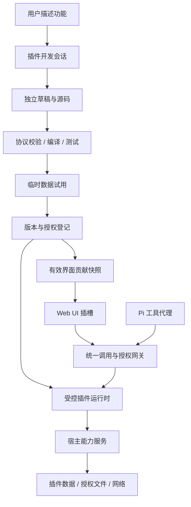

# 打包后可由 AI 开发的插件架构

状态：应用插件 v1 闭环已实现。用户从主聊天入口打开软件内默认插件开发工作区，与 AI 直接对话；AI 可在该目录内受限地读写清单、查询已安装插件、校验版本并在用户批准后安装。安装后宿主根据清单动态生成工作区侧栏入口、字段表单、表格/看板页面和插件数据工具。插件数据按项目工作区隔离，插件变化会在会话空闲边界刷新工具注册。

v1 只接受声明式 JSON，宿主渲染 UI 并执行固定的数据增删改查，不运行插件代码。其范围足以在打包后由 AI 增加清单协议支持的字段、页面和数据操作，且无需重新构建 Web UI。任意代码插件、用户编写 React 页面、字段迁移和版本回滚属于后续协议版本，当前版本会拒绝未声明属性或不兼容的数据字段。

## 1. 目标与使用流程

软件打包后，用户仍可在软件内描述缺少的功能，由 AI 编写声明式插件清单并安装到当前软件实例。新增字段、表格/看板页面、导航入口和固定数据操作不需要修改应用源码、重建 Web UI 或重新打包桌面程序。

例如用户提出“增加一个项目待办看板，并允许 AI 维护任务”：

1. 从“技能与插件 / 模型与设置”所在的侧栏底部选择“插件开发”。软件复用唯一的插件开发会话和持久化的默认开发工作区。
2. 在主聊天框描述需求。AI 查询现有插件后，在 `plugins/<plugin-id>.json` 中创建或编辑清单。
3. AI 调用 `plugin_validate` 检查字段、视图、导航、版本号和数据兼容性；读操作不需要额外确认。
4. 用户在聊天确认卡片中批准文件修改和 `plugin_install`。宿主再次校验清单，写入不可变版本并启用插件。
5. 当前工作台刷新插件注册表；所选项目的侧栏出现新入口，页面以宿主组件呈现，聊天会话在本轮结束后刷新可用插件数据工具。
6. 后续在同一聊天中提出变更。升级必须提高版本，且 v1 要求保留已安装字段的 ID、类型、必填状态和选项。

v1 的必要能力是本地开发、清单校验、用户确认、动态界面和按工作区隔离的数据。插件市场、账号同步、多人协作、任意代码和原生依赖不属于 v1。

## 2. 当前代码与缺口

| 当前入口 | 已有能力 | 需要补充的能力 |
| --- | --- | --- |
| `apps/server/src/app-plugins.ts` | 校验清单、版本兼容、不可变发布、启停、记录 CRUD | 字段迁移、回滚和事务恢复 |
| `apps/server/src/agent.ts` | 默认开发会话、隔离资源、限定文件工具和插件数据代理 | 更丰富的宿主能力与逐能力授权 |
| `apps/server/src/app.ts` | 固定默认开发工作区、安装接口、插件数据路由 | 跨窗口的注册表推送与恢复接口 |
| `apps/server/src/tool-policy.ts` | 校验/列表只读；文件写入和插件安装需确认 | 按插件声明新增粒度更细的能力权限 |
| `apps/web/src/pages/AppPluginPage.tsx` | 按清单字段渲染表单、表格和看板 | 更多受限 UI 组件或沙箱页面 |
| `apps/web/src/App.tsx` | 聊天开发入口、动态侧栏导航和插件路由 | 面板、设置区等额外 UI 插槽 |
| `desktop/src-tauri/src/main.rs` | 将持久化数据目录传给本地服务 | 安装包验证与备份/恢复 UX |

已有 Pi 扩展具有宿主进程权限，其终端 UI 也不能直接成为 React 页面。因此应用插件与 Pi 扩展保持不同类型：AI 生成的 v1 应用插件只包含严格校验的 JSON，不继承可信 Pi 扩展权限。

仓库的实验性 Chord 插件已有 session/tui facets 和 generation 切换机制，参考 `packages/coding-agent/examples/plugins/pi-example-plugin/README.md`。当前 Web 服务使用进程内 SDK，未接入这套服务器；首期不同时迁移整个运行架构。可借鉴版本代次和贡献清理规则，后续如接入 Chord，仍沿用本文的应用层协议。

保留现有 Pi 扩展入口，将它标为“可信 Pi 扩展”；新增“应用插件”入口。两者是不同执行能力，不假定旧扩展自动具备新插件的 UI 和权限约束。

## 3. 总体结构

当前 v1 的调用链是“主聊天 → 默认开发工作区 → 清单校验和审批 → 插件注册表 → 动态页面与 AI 数据工具 → 宿主验证后的工作区记录”。下图说明未来增加可执行能力插件时的扩展目标，不代表 v1 已运行插件代码。



插件清单描述“提供什么”，运行时代码实现“如何执行”，宿主决定“能访问什么”。UI 与 AI 调用同一命令，不分别实现两套业务逻辑。

宿主保有窗口、聊天、供应商登录、授权和插件管理权。插件通过明确插槽增加功能；若需求超出当前 SDK，开发会话应报告缺少的宿主能力，不能声称所有功能都可通过插件实现。

## 4. 文件与打包布局

```text
AllWeaveBuild/
  AllWeaveBuild.exe
  data/
    plugin-workspace/              固定开发工作区，AI 清单保存在 plugins/*.json
      plugins/
    sessions/                      包含插件开发聊天的宿主会话记录
    plugins/
      registry.json                已安装清单、内容哈希、启用状态
      releases/<pluginId>/<digest>/plugin.json  不可变清单版本
    plugin-data/<pluginId>/<workspaceId>.json   工作区隔离的插件记录
```

服务端由桌面启动参数提供数据目录，开发模式由 `AppOptions.directory` 提供。默认开发工作区固定在该数据目录的 `plugin-workspace` 子目录；它不列入用户项目，也不受项目工作区的删除和重命名操作影响。清单源码、会话、插件注册表和业务数据均随应用数据目录持久保存。

v1 发布清单按 SHA-256 哈希寻址；安装不会执行其 JSON 之外的文件。修改清单后必须升高版本，不能就地替换已安装产物。注册信息和业务数据分开保存。应用更新替换程序文件，保留 `data`；备份应同时包含插件开发工作区、会话、注册表、发布清单和插件业务数据。

## 5. 插件协议

以下是后续能力型插件的目标协议，不是当前最小清单格式，也不是现有 Pi API。当前版本只接受 `manifestVersion`、`id`、`name`、`version`、`description`、`fields`、`views` 和 `navigation`，未知字段会被拒绝。能力型插件阶段才会加入下面的 SDK 版本、运行时、命令、工具和 UI 声明。

```json
{
  "manifestVersion": 1,
  "id": "local.project-tasks",
  "name": "项目待办",
  "version": "0.1.0",
  "requires": { "hostApi": 1, "uiSchema": 1 },
  "runtime": { "kind": "sandbox-js", "entry": "dist/plugin.js" },
  "permissions": [
    { "capability": "storage", "scope": "workspace" }
  ],
  "commands": [
    {
      "id": "list",
      "description": "查询当前项目待办",
      "inputSchema": { "type": "object", "properties": {}, "additionalProperties": false },
      "outputSchema": { "type": "array", "items": { "type": "object" } }
    }
  ],
  "tools": [
    { "id": "list_tasks", "command": "list", "description": "查询当前工作区的任务" }
  ],
  "ui": {
    "navigation": [{ "id": "tasks", "title": "项目待办", "page": "board", "icon": "list" }],
    "pages": [{ "id": "board", "schema": "ui/board.json" }],
    "panels": [{ "id": "summary", "title": "待办", "view": "ui/summary.json", "slot": "workspace.panel" }]
  }
}
```

协议约束：

- `id` 使用受限 ASCII 标识符；示例是本地命名空间，不对应 npm 包名。工具对外名称由宿主生成，并检测规范化后的冲突，不能覆盖内置工具。
- 命令输入和输出均使用受限 JSON Schema 校验；不接受远程 `$ref` 或运行时下载 schema。工具引用命令，继承其参数协议。
- 工具调用记录保存插件 ID、内容哈希、工具 ID 和结构化结果。历史记录不依赖当前插件是否安装。
- SDK、UI schema、业务数据分别有版本。首期要求宿主 API 主版本精确匹配；应用版本升级不必修改每个插件版本。
- 清单声明只是能力请求；正式授权保存在宿主，按插件内容哈希、工作区和能力绑定。
- 注册时验证静态命令、工具和 UI 引用。插件运行后只能返回这些声明对应的数据，不能偷偷追加权限或入口。

插件工程包含 `plugin.json`、`src/plugin.ts`、`ui/*.json`、`tests/` 和锁定的依赖信息。SDK 提供命令处理、存储、文件、网络、取消信号、进度和日志的类型；不直接暴露整个 `ExtensionAPI`。

## 6. 执行方式与权限

本节的 v1 说明覆盖实际实现；本节后续关于代码沙箱和宿主能力代理的内容，是未来任意代码插件的设计约束。

v1 采用声明式数据插件：清单只能描述字段、表格/看板和记录；宿主执行固定的增删改查，不运行插件提供的代码。开发聊天使用软件固定的插件开发工作区，不加载项目指令、扩展、技能、提示模板、主题或上下文文件。只启用受限的 `read`、`edit`、`write`、`plugin_list`、`plugin_validate` 和 `plugin_install` 工具；不提供 shell、浏览器、MCP 或项目扩展。写文件和安装插件通过主聊天中的确认卡片授权。

`plugin_list` 和 `plugin_validate` 是只读操作。`plugin_install` 重新解析 JSON 并检查版本及字段兼容性后，原子保存不可变发布内容和注册表；安装失败不会改变当前插件。插件业务数据由宿主验证字段和类型并按项目工作区保存。

v1 不支持任意代码能力，因而不把 Node 子进程、Worker、`node:vm` 或不完整的第三方运行时误称为安全沙箱。后续若加入代码插件，必须先选定独立运行时并通过第 12 节的隔离与打包验收。

不把 Node 子进程、Worker 或 `node:vm` 本身当成权限沙箱。插件代码不进入服务主进程，不获得 `process`、Node 模块、环境变量、原始文件系统、套接字或宿主 JavaScript 对象。引擎不提供任意模块加载；宿主在构建时处理静态依赖，运行时只执行已验证产物。

宿主能力通过消息请求，例如读取当前工作区的相对路径。服务端从已认证会话解析工作区与插件身份，不接受插件自报身份或任意绝对路径作为授权依据。每次操作重新检查授权、路径和当前权限模式。

| 能力 | 宿主执行规则 |
| --- | --- |
| 插件存储 | 默认仅自己的当前工作区空间；限制容量，写入串行化 |
| 工作区文件 | 沿用授权根目录、私有路径和链接检查；授权时区分读取与写入 |
| 网络 | 宿主代理请求；限制域名、协议、重定向和内网目标；不得连工作台管理接口 |
| 凭据 | 首期不提供；后续提供特定连接的请求代理，不将模型密钥或令牌返回插件 |
| 命令和原生模块 | 首期受控插件不提供；需扩展专门宿主能力或显式安装可信原生扩展 |
| 会话信息 | 默认只含选定工作区、会话 ID；消息历史需要独立权限 |

有效权限为：插件请求 ∩ 用户授权 ∩ 工作区范围 ∩ 当前调用上下文限制。当前声明式界面的用户点击由宿主按清单和工作区执行并校验；AI 发起的插件工具调用沿用会话现有审批策略。后续任意能力型插件的 UI 按钮和 AI 工具都应经过同一个宿主能力网关，不能由插件自行声明免审。

限制单次调用时长、内存、消息体、输出、日志和事件速率。取消时先传播取消信号，再在超时后终止进程，并撤销该调用的宿主请求。所有订阅、计时任务和进度通道按插件代次登记，停用时清理。

进程终止不保证外部副作用回滚；写文件采用宿主原子写入，网络写操作按请求 ID 防止可识别的重复提交，结果不明时显示“需检查”，不自动重试。现有路径检查依赖可信本地环境的限制仍适用，不宣称能够抵御同账户恶意进程。

现有可信 Pi 扩展继续按现有权限运行；它们不能因为出现在插件列表中就被标记为受控插件。默认不允许 AI 创建功能时自动切换到可信模式。

## 7. Web UI 如何适应插件

v1 的插件注册表就是统一贡献快照。前端根据当前工作区读取清单，由通用组件渲染导航入口和页面；新增插件不需要增加 `PluginFeatureId` 联合类型或按插件 ID 写条件分支。

| 插槽 | 插件可贡献的内容 | 宿主保留的约束 |
| --- | --- | --- |
| `navigation` | 已实现：插件入口 | 依据 manifest 列表和当前工作区生成侧栏链接 |
| `page` | 已实现：表格或看板 | `/plugins/:pluginId/:viewId?workspace=...` 通用路由 |
| `workspace.panel` | 后续版本 | v1 暂不接受 |
| `settings.section` | 后续版本 | v1 暂不接受 |
| `tool.result` | 后续版本 | v1 沿用宿主工具记录视图 |
| `composer.action` | 后续版本 | v1 暂不接受 |

当前仅支持声明式 `form`、`table` 和 `board`：字段类型定义创建/编辑表单，表格呈现记录，看板按已存在字段分组。宿主执行数据校验和增删改查；没有插件提供的 HTML、脚本表达式或 CSS 注入。

看板按 manifest 指定的 `groupBy` 字段分组；表单和视图都使用相同的字段 schema。用户操作和 AI 插件数据工具共用服务端的记录校验与存储实现。

工具结果默认显示在现有工作区工具记录中，不额外挤入聊天正文。插件卸载或结果 schema 不兼容时，回退到宿主的文本/JSON 视图，历史工具记录仍可读。

界面更新规则：

1. AI 安装工具完成后，当前聊天收到 `tool.completed`，前端重新获取插件注册表并更新侧栏。
2. 启用后出现入口，停用后移除入口；每次路由都按稳定的插件 ID、视图 ID 和工作区 ID 解析。
3. 插件页面沿用宿主主题、字体、焦点和动效，遵守 `docs/workbench-ui.md` 的布局约束。
4. 重启后服务端从应用数据目录读取注册表，前端重新获取当前快照。

任意自定义页面和聊天旁的插件面板不在 v1 协议中。若未来引入，必须通过独立沙箱 iframe、严格 CSP 和专用消息通道运行；不能在宿主 React 根中加载插件代码，浏览器与 WebView2 的隔离行为需专项验证。

## 8. 软件内的 AI 开发工作流

插件开发入口直接位于主聊天旁边。服务端创建或复用唯一的 `plugin-development` 会话，并绑定应用数据目录下的默认开发工作区。会话不加载任何项目资源；模型可以通过受限文件工具编写清单，而不是只能在回复中输出 JSON。文件引用被拒绝，模型设置从应用级配置读取。

当前宿主管理工具如下：

| 工具 | 用途 |
| --- | --- |
| `plugin_list` | 读取已安装清单和版本 |
| `plugin_validate` | 校验协议、版本递增和字段兼容性 |
| `plugin_install` | 请求用户批准后安装、启用并通知宿主刷新插件工具 |

用户确认 `plugin_install` 后，服务端再次解析并校验文件，验证通过才提交注册表和不可变发布清单。AI 无法修改授权状态或绕过审批。当前状态由会话状态、注册表 `enabled` 标记和校验错误表示；安装、启用、停用、卸载在插件管理页操作。开发会话使用用户已配置的模型，模型不可用时遵循普通会话的提示和错误处理。

## 9. 安装、热更新与恢复

v1 没有可执行代码、压缩包或外部依赖。服务端解析单个 JSON 清单，写入 `plugins/releases/<id>/<sha256>/plugin.json`，再原子替换注册表文件。版本必须递增，字段 schema 必须保持兼容；失败的校验不会发布新版本。停用立即移除 UI 和新工具注册，空闲会话会重建；卸载保留已保存的工作区数据。

以下事务、迁移和回滚步骤是未来支持任意代码插件时的目标，不是当前实现：

默认生成插件只依赖随软件提供的 SDK。纯 JavaScript 第三方依赖作为后续能力，在受控下载及构建流程中固定版本、保留锁文件、禁用生命周期脚本并限制构建器可访问路径。原生依赖和外部 Python/Rust 工具链不属于首期“开箱即用”的承诺。

启用及更新按插件与作用域串行执行，并检查 `expectedRevision` 防止两个窗口覆盖彼此：

1. 检查兼容性、产物哈希、测试报告和授权。
2. 在临时运行环境做初始化与健康检查；此时不发布 UI 或工具。
3. 如有数据迁移，先阻止受影响插件的新调用，等待在途操作完成，再建立一致备份并执行迁移。
4. 原子更新版本指针与贡献注册表，持久化提交记录后通知 UI。
5. 清理旧代次的订阅、进程和临时资源。失败则不发布新代次，恢复数据和旧指针。

文件注册表采用同卷临时文件替换和提交日志；启动时恢复未完成事务。迁移后的数据不能直接交给旧代码：回退必须恢复对应数据快照，或者明确阻止无法回退的操作。外部服务变化不能随版本指针回滚，更新摘要必须列出此限制。

会话按一次用户任务绑定插件代次，工具调用的整个生命周期使用同一版本。更新时空闲会话在下一任务绑定新代次；运行中会话继续旧版本，UI 也按所选会话获取有效快照，避免新页面调用旧命令。需要迁移时等待所有受影响调用退出，超时后让用户选择稍后更新或停止任务。

当前 Pi 工具注册不能直接注销。实现稳定的宿主扩展适配器：预先注册当前插件清单中的代理工具，版本内部变化由代理转发；工具集合变化在空闲边界重建受影响的 SDK 会话并恢复 JSONL，不能假定删除 Map 即可移除模型工具。持久化该会话选用的插件哈希；重启后旧版本缺失时显示诊断，不静默替换为其他版本。

停用立即拒绝新调用，取消相关审批和在途操作，移除 UI 贡献；旧模型上下文中的工具再被调用时返回“插件已停用”。插件卸载默认保留数据，清除数据是单独操作。启动时某插件反复崩溃则隔离该插件，核心聊天与插件管理页仍可打开。

## 10. 服务与共享协议

建议新增 `apps/server/src/plugins/`，按职责分文件：

| 文件/目录 | 职责 |
| --- | --- |
| `manifest.ts`、`paths.ts` | 清单校验、版本兼容和路径解析 |
| `registry.ts`、`lifecycle.ts` | 作用域绑定、事务、启停、版本恢复 |
| `runtime/`、`capabilities/` | 执行引擎、消息协议、宿主能力与限额 |
| `agent-bridge.ts` | 将插件命令转为 Pi 工具，统一审批、取消与用量 |
| `development.ts` | 草稿开发会话、验证任务和试用实例 |
| `routes.ts` | 受认证管理接口与调用网关 |

`apps/shared/src/plugins.ts` 保存序列化协议与校验 schema；运行时句柄、函数及 Node 类型不得出现在前后端共享消息中。前端增加 `src/plugins/`，集中贡献缓存、插槽渲染、通用页面、命令调用和错误边界。

拟新增接口：

| 接口 | 行为 |
| --- | --- |
| `GET /api/app-plugins` | 安装状态、诊断、版本和作用域 |
| `GET /api/app-plugins/contributions?workspaceId=...&sessionId=...` | 服务端解析有效上下文，返回 revision 与贡献快照 |
| `POST /api/app-plugin-drafts` | 根据需求建立开发任务 |
| `GET /api/app-plugin-jobs/:jobId` | 恢复开发、验证和发布进度 |
| `POST /api/app-plugin-drafts/:draftId/validate` | 宿主选择工具链并验证 |
| `POST /api/app-plugin-drafts/:draftId/preview` | 创建有期限的试用实例 |
| `POST /api/app-plugins/:pluginId/enable` | 按哈希、作用域、预期 revision 启用 |
| `POST /api/app-plugins/:pluginId/disable` | 撤销调用入口并清理贡献 |
| `POST /api/app-plugins/:pluginId/rollback` | 按数据恢复规则回退 |
| `POST /api/app-plugins/:pluginId/commands/:commandId` | UI 发起受校验调用，返回调用 ID |

调用结果与进度支持取消、超时、过期和结构化错误，审批通过后继续原调用，不能由客户端重新提交一遍。试用调用绑定 preview ID，不能使用正式数据身份。工具调用与界面调用共享业务执行路径，但保留发起者、审批和审计来源。

使用 `/api/app-plugins` 避免覆盖现有 `/api/plugins/mcp-config` 和 `/api/plugins/git`。插件管理事件使用独立消息类型，不能假冒 `SessionEvent` 或修改聊天事件序号。所有新路由沿用现有 Cookie、Host、Origin 和 WebSocket 验证，管理接口不向插件运行时或自定义 iframe 暴露。

## 11. 打包要求

v1 不需要在用户电脑安装插件编译器、TypeScript 或原生构建工具。安装包把 `apps/server/src`、`apps/shared` 和 `apps/web/dist` 与服务依赖一起携带；插件开发与运行使用这些已打包的宿主能力，不会在用户机器上构建代码。开发工作区自动创建在安装目录的 `data/plugin-workspace`，注册表和记录也保存在同一 `data` 目录。

清单解析、版本检查、字段校验和页面渲染本地完成；AI 生成仍需要一个可用模型服务。若未来允许插件代码，才需要随包携带经过隔离验证的编译器、运行时、测试工具和资源清单，不能依赖仓库 `node_modules` 或开发测试目录。

## 12. 实施顺序与验收

### 已完成：声明式 v1 闭环

实现固定插件开发工作区和主聊天入口、限制工具目录、清单校验与用户批准安装、按工作区隔离的数据、版本兼容检查、动态侧栏/页面和会话工具刷新。专项测试使用临时目录与 faux 模型覆盖注册表、开发会话、安装审批及运行会话刷新。

### 后续阶段一：验证代码插件运行与分发边界

建立受控引擎、宿主消息桥和最小清单原型。在无系统 Node/npm、路径含中文与空格的 Windows 环境，验证安装后的程序可从插件源码编译并执行；验证无限循环、超大消息、取消、越权文件与网络请求。引擎不能满足隔离和分发要求时，在此阶段更换方案，不把普通 Node 子进程临时标为安全模式。

### 后续阶段二：扩展插件到更多界面

实现注册表、工作区授权、稳定 Pi 代理、贡献快照与声明式 UI。交付一个“项目待办”参考插件，覆盖 AI 工具、页面、右侧面板、数据持久化、停用和版本切换。固定插件界面先保留；后续逐个迁移到统一贡献系统，每次验证原功能仍可用。

### 后续阶段三：软件内源码开发与版本恢复

加入开发会话、模板、检查、试用、发布摘要和恢复记录。用户从一句需求开始，到启用工具与页面，全程无需修改应用源码或重启桌面程序。失败版本不得替换正常版本，修改需求继续生成草稿。

### 后续阶段四：高级扩展

在声明式 UI 已有实际限制时增加自定义沙箱页面，再考虑受控第三方依赖、插件导入导出与分发。插件间调用、后台定时任务和原生能力各自扩展协议与权限，不提前默认开放。

v1 验收覆盖：

- 在应用主聊天中创建并安装声明式插件；安装后动态导航、页面、字段表单和 AI 工具可用，宿主 Web 源码无需按插件 ID 修改。
- 界面与 AI 操作共用同一插件数据；工作区 A 的记录与工作区 B 隔离。
- 文件写入和插件安装进入聊天审批；拒绝安装时注册表不变。
- 新安装与版本升级通过同一套协议和字段兼容校验；插件更改在当前会话结束后刷新工具集合。
- 测试使用临时目录和 faux 模型，不依赖真实 API 密钥或付费模型。

未来代码插件阶段还需验证打包环境、隔离、试用、迁移/回滚、多窗口推送、崩溃隔离和额外 UI 插槽；这些不是 v1 验收结果。

声明式 v1 架构与实现已经闭环。任意代码运行时、试用数据、数据迁移/回滚和额外 UI 插槽明确留给后续版本；不能将它们作为当前插件的能力对外承诺。
